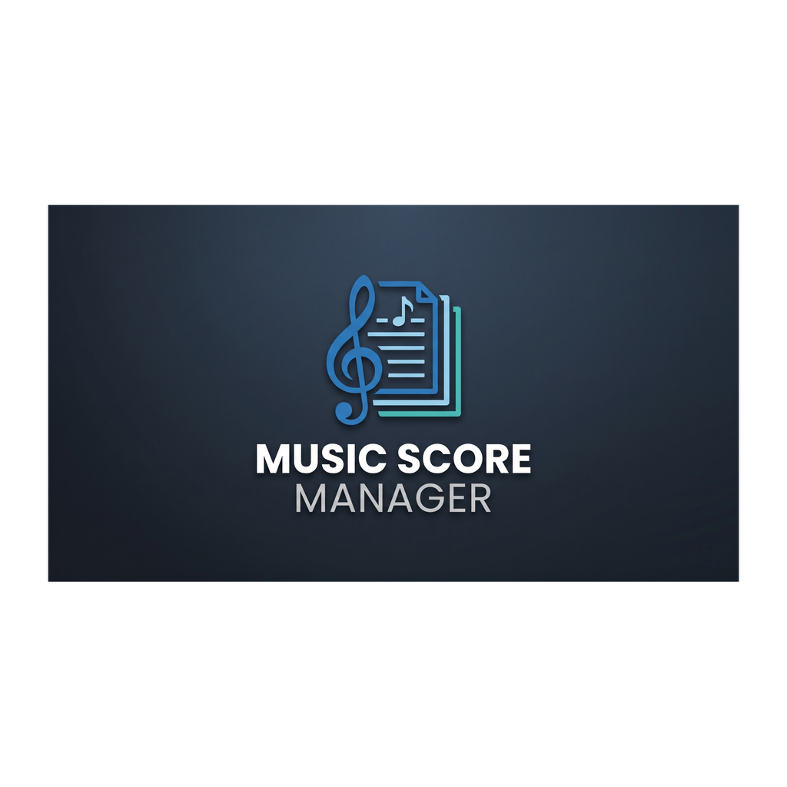
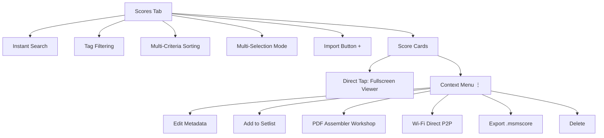
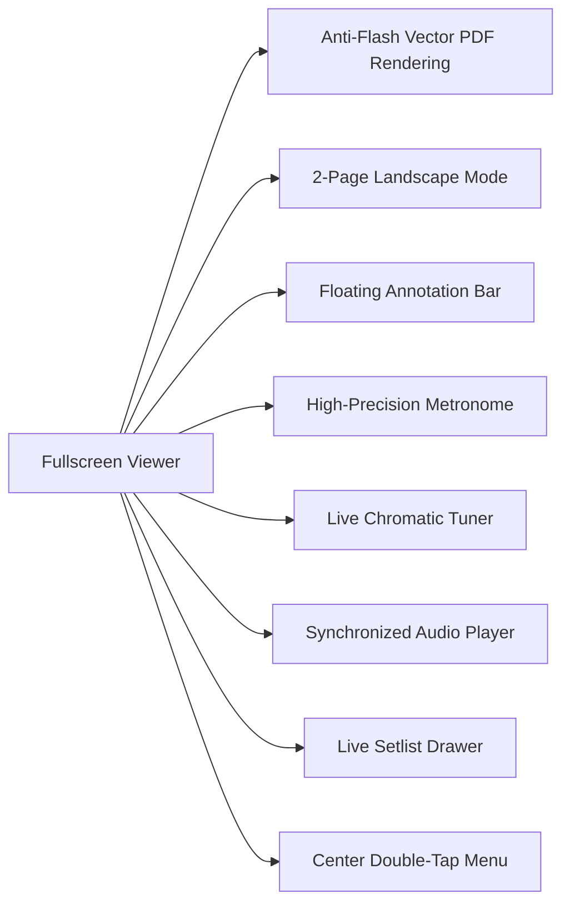
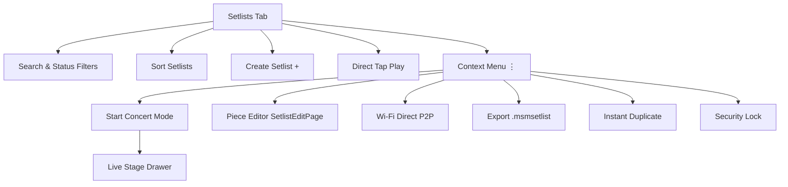
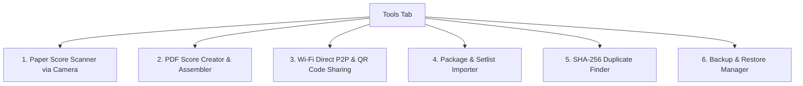
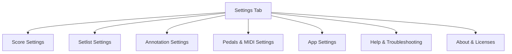

<p align="center">
  
</p>

<p align="center">
  🇬🇧 <b>English</b> | <a href="README.fr.md">🇫🇷 Lire en français</a>
</p>

# Music Score Manager
> **The professional sheet music manager & live performance reader for rehearsals, music stands, and concerts.**

---

## 📑 Table of Contents

1. [Chapter 1: Application Overview, Installation & Requirements](#chapter-1-application-overview-installation--requirements)
2. [Chapter 2: Scores — Actions, Library & Stage Viewer](#chapter-2-scores--actions-library--stage-viewer)
3. [Chapter 3: Setlists — Program Organization & Stage Flow](#chapter-3-setlists--program-organization--stage-flow)
4. [Chapter 4: Tools — Advanced Utility Box](#chapter-4-tools--advanced-utility-box)
5. [Chapter 5: Settings — Customization & Preferences](#chapter-5-settings--customization--preferences)
6. [Chapter 6: Technical Details, Privacy, Rights & GitHub Links](#chapter-6-technical-details-privacy-rights--github-links)
7. [Acknowledgments & Contributors](#acknowledgments--contributors)

---

## Chapter 1: Application Overview, Installation & Requirements

### 1.1 General Presentation & Philosophy
**Music Score Manager** is a cross-platform application built with **.NET 10 MAUI**, primarily designed for **Android** tablets and smartphones (as well as **Windows** workstations). Built by musicians for musicians, it meets the most demanding requirements of musical practice: section rehearsals, personal practice, music lessons, dress rehearsals, and live stage performances.

The application permanently eliminates heavy paper binders and replaces generic PDF readers that are ill-suited for the stage. It provides a tailor-made experience:
- **100% Offline & No Network Dependency**: Your entire sheet music library, database, metadata, annotations, and backing audio tracks are stored locally on your device. No internet connection is ever required on stage.
- **Instant Responsiveness (< 50 ms)**: Optimized architecture without redundant file copies (*zero-copy*), featuring offscreen pre-rendering (*offscreen canvas double-buffering*) for lag-free, seamless page turns.
- **Stage Visual Comfort**: Pure Dark Mode theme (`#121212`) preventing stage glare and eliminating white flashes during score loading.
- **Complete Hands-Free Control**: Native support for wireless Bluetooth page-turner pedals (HID and keyboard profiles) as well as MIDI controllers (USB-OTG and Bluetooth MIDI).
- **Professional Annotation Suite**: Stylus, freehand pen, translucent Stabilo highlighters, typed text, and over 100 built-in musical symbols/stickers.
- **Integrated Stand Utilities**: High-precision metronome (thread-safe SoundPool engine) and live chromatic tuner embedded directly inside the score viewer.

---

### 1.2 System & Hardware Requirements

| Component | Minimum Requirement | Recommended for Stage |
| :--- | :--- | :--- |
| **Operating System** | **Android 10.0** (API 29) or higher *(Compatible from API 21)* | **Android 13 / 14 / 15 / 16** (Target SDK 36) |
| **Desktop Alternative** | **Windows 10** (build 19041+) | **Windows 11** with touch screen or stylus |
| **Screen & Display** | 8-inch touch screen | **10.5 to 13.3-inch tablet** (high resolution, 4:3 or 16:10 aspect ratio) |
| **Storage** | 200 MB free space for the app | 4 GB+ depending on your PDF/Audio library size |
| **RAM** | 3 GB RAM | 4 GB to 8 GB RAM |
| **Pedal Controllers** | Touch screen | **Bluetooth HID Pedal** (AirTurn, PageFlip, Joyo, Donner...) or **MIDI Controller** |
| **Network Connection** | No internet connection required | Wi-Fi adapter active only for direct P2P sharing between musicians |

---

### 1.3 Installation & Deployment

#### 📱 For Android

##### Method 1: Installation via Google Play Store (Recommended)
This is the simplest, fastest, and most secure method:
1. Open the **Google Play Store** on your Android tablet or smartphone.
2. Search for **Music Score Manager** (developed by *Audiothor*) or open the store listing directly:  
   👉 [**Music Score Manager on Google Play Store**](https://play.google.com/store/apps/details?id=com.audiothor.musicscoremanager)
3. Tap **Install**. Official updates will be delivered automatically.

##### Method 2: Manual Installation via APK Package (Offline)
For devices without Google Play services or for fully autonomous usage:
1. Download the latest signed APK file (`MusicScoreManager-vX.Y.Z.apk`) from the [GitHub Releases page](https://github.com/Audiothor/MusicScoreManager/releases).
2. On your Android device, allow installation from unknown sources (*Settings > Security > Install unknown apps*).
3. Open the APK file and confirm installation.
4. On first launch, grant the necessary permissions for score files, microphone (tuner), and camera (paper score scanner).

---

#### 💻 For Windows (PC, Laptops & Surface Tablets)
**Music Score Manager** runs natively on **Windows 10** (build 19041+) and **Windows 11** with touch, mouse, stylus, and keyboard shortcut support:
1. Download the Windows zip archive (`MusicScoreManager-Windows-vX.Y.Z.zip`) from [GitHub Releases](https://github.com/Audiothor/MusicScoreManager/releases).
2. Extract the archive into your preferred folder (e.g. `C:\Programs\MusicScoreManager`).
3. Launch `MusicScoreManager.exe` (you can create a desktop shortcut or pin it to the Taskbar).
4. *(If Windows SmartScreen prompts on first launch, click "More info" and select "Run anyway").*

---

#### 🛠️ For Developers: Building from Source (.NET MAUI)
1. Install the **.NET 10 SDK** and the .NET MAUI workloads:
   ```powershell
   dotnet workload install maui
   dotnet workload install maui-android
   dotnet workload install maui-windows
   ```
2. Clone the official Git repository:
   ```powershell
   git clone https://github.com/Audiothor/MusicScoreManager.git
   cd MusicScoreManager
   ```
3. Build for your target platform:
   ```powershell
   # For Android: build and publish Release package
   dotnet build -t:Run -f net10.0-android
   dotnet publish -f net10.0-android -c Release

   # For Windows: build Release executable
   dotnet build -f net10.0-windows10.0.19041.0 -c Release
   dotnet publish -f net10.0-windows10.0.19041.0 -c Release
   ```

---

## Chapter 2: Scores — Actions, Library & Stage Viewer

The **Scores** tab is the main entryway to your musical repertoire. It lets you organize, sort, search, edit, and read your sheet music in full screen.



### 2.1 Top Toolbar & Global Actions
The top toolbar provides immediate management tools:
- **Display View Toggle (`📁 / ☰`)**:
  - **List View (📋)**: Smooth linear view of all scores with continuous scrolling and custom sorting.
  - **Folder View (📁)** : Grouping by physical directories/categories (collapsible/expandable accordion, score count, direct folder management).
- **Search Bar (`SearchBar`)**: Real-time filtering as you type by score title, composer name, or file name.
- **Tag Filter Button (`🏷️`)**:
  - Opens an interactive modal with internal search bar and tag sorting (A-Z, Z-A, most used, least used).
  - Select one or more tags to show matching scores.
  - Horizontal active tags bar shown under the toolbar with colored chips and one-tap remove buttons.
  - *“Clear all”* and *“Apply”* buttons.
- **Multi-Criteria Sort Button (`⇅`)**:
  - *Date added (Newest first)* [Default]
  - *Date added (Oldest first)*
  - *Title (A-Z)* and *Title (Z-A)*
  - *Last modified date*
  - *Rating (Star rating)*
  - *Composer (A-Z)*: respects the preference for scores without composer (placed at top or bottom).
  - *Untagged first*: ideal for identifying freshly imported scores that need tagging.
- **Multi-Selection Button (`☑`)**:
  - Enables checkboxes on every score card.
  - Displays a bottom batch action bar with a dynamic counter (*"X selected"*):
    - 🗑️ **Batch Delete**: Safe deletion with confirmation dialog.
    - 🏷️ **Batch Tags**: Opens a modal to add tags to all selected scores or replace all their tags.
    - 📦 **Batch Export (`.msmscores`)**: Generates a unified bundle archive with options to include or exclude handwritten annotations and audio tracks.
    - 📤 **Batch Send**: High-speed Wi-Fi Direct transfer of selected scores to another tablet.
- **Import Button (`+`)**:
  - **PDF Document Import**: Select one or multiple PDF files. Strict binary validation checks the `%PDF-` header to reject corrupted files.
  - **Image Import & Conversion**: Selecting image files (PNG, JPEG, GIF, WEBP, BMP) prompts the user that images will be converted to high-definition PDF format:
    - *If cancelled*: Images are ignored. Any accompanying PDF files continue normal import.
    - *If confirmed*: Images are converted into crisp PDF documents. A modal progress dialog with live status keeps the user informed. For multiple images, choose between merging into a **single multi-page PDF score** or generating individual scores. Upon completion, an explicit confirmation is displayed and the library immediately refreshes with all tags preserved.
  - **Copy Mode vs. Link Mode**: Configurable to either copy the file into app storage or link to its original external storage path (indicated by a `🔗` badge).

---

### 2.2 Score Cards & Visual Badges
Each score is displayed as a modern, informative card:
- **Score Title**: Clear typography with automatic text wrapping.
- **Red Alert Badge `(!)` & Red Title Text**: Visual warning if the physical PDF file is missing or has been moved from storage, preventing stage surprises.
- **Blue `🔗` Badge**: Indicates an externally linked file.
- **Customizable Subtitle**: Shows composer name, date added, or both.
- **Colored Tag Badges**: Distinctive color pills displaying musical genre, instrument/part, or project.
- **Options Menu Button (`⋮`)**: Opens the detailed context menu.
- **Fast Alphabetical Index Strip (`A-Z`)**: Subtle strip on the right edge during alphabetical sorting (by title or composer) to jump directly to any letter.
- **Floating "Top of Page" Button (▲)**: Unobtrusive button appearing when scrolling down to instantly return to the top of the library.

---

### 2.3 Score Context Menu (`⋮`)
Tapping the 3 dots on any score card opens a dark, modern modal card offering all available actions:
1. 📖 **Open Score**: Launches the fullscreen stage viewer.
2. ✏️ **Edit Score**: Opens the detailed `ScoreEditPage`:
   - *Title & Composer*
   - *Key Signature*: Standard international (A, B, C, D, E, F, G with major/minor accidentals) and classical solfège (Do, Ré, Mi, Fa, Sol, La, Si).
   - *Tempo (BPM)*: Metronome reference speed.
   - *Rating*: 1 to 5 star rating.
   - *Associated Tags*: Dynamic tag addition and removal.
   - *Metronome Settings*: Time signature (2/4, 3/4, 4/4, 6/8...), rhythmic subdivision, count-in bars, and default mute/unmute state.
   - *Backing Audio Tracks*: Link one or more audio accompaniment files (MP3, WAV, AAC, OGG, FLAC), listen to preview clips, adjust relative volume, and remove tracks.
   - *Technical Metadata*: Full physical path, parent directory, file size, file type, added date, and last modified date.
   - *Missing File Alert*: Direct file re-picker button if the PDF was relocated.
3. 📋 **Add to Setlist**: Displays the setlist list. The score is inserted **at the 1st position** of the chosen setlist for quick stage preparation. If the setlist is locked, a confirmation is requested. If already present, it is repositioned without duplicating.
4. 📑 **Modify PDF Assembly**: Opens the score directly in the PDF Assembler to reorder, rotate, or remove pages.
5. 📡 **Send via Wi-Fi Direct**: Displays transfer options (*Include handwritten annotations*, *Include audio tracks*) before launching peer-to-peer wireless transfer.
6. 📦 **Export (.msmscore)** : Exports a complete self-contained archive package via USB, messaging, or cloud with annotation/audio toggles.
7. 🏷️ **Rename**: Fast inline dialog to modify the display title.
8. 🗑️ **Delete Score**: Secure deletion with confirmation dialog.

---

### 2.4 Fullscreen Score Viewer (`ViewerPage`)
The viewer is the operational cockpit during rehearsals and concerts:



#### Rendering & Performance
- **Optimized Vector PDF Engine**: High-fidelity vector rendering without pixelation when zooming.
- **Synchronous Anti-Flash Display**: Annotation layer and score render at the exact same instant, completely eliminating "floating annotations" glitches.
- **Offscreen Canvas Pre-buffering**: Adjacent pages are pre-rendered in memory for near-zero latency page turns.

#### 2-Page Landscape Mode
- When *Display 2 pages in landscape* is enabled in settings and the device is horizontal, the viewer displays two consecutive pages side by side.
- **Precise Geometric Projection**: Annotations created in portrait mode (or on a single page) project with millimeter accuracy onto the left (`leftPage`) or right (`rightPage`) page, taking letterboxing and pillarboxing into account.
- **Scale Adaptation**: Pen stroke widths, sticker dimensions, and font sizes automatically adjust to the 50% page width reduction.

#### Navigation & Touch Gestures
- **Touch Page Turning**: Customizable tap zones (tap left / tap right) and swipe gestures (swipe left, swipe right, swipe up / down).
- **Unified Zoom & Pan**: Two-finger pinch-to-zoom and free panning, 100% synchronized with the annotation overlay.
- **Page Indicator & Direct Jump**: Tappable badge in bottom right corner (`e.g. 3/12`). Tapping opens a quick numeric page jump dialog.

#### Modern Central Menu (Double-Tap)
A double tap in the center of the screen reveals a fast action menu:
- **↻ Rotation (+90°)**: Rotates the score in 90-degree increments.
- **Rotation Scope**: Switch between applying rotation to the current page only or to all pages.
- **Saved Rotations**: Automatically persists the chosen angle in the local database.
- **🔍 Reset Zoom (100%)**: Instantly resets zoom and centers the score.
- **📄 Page Jump**: Quick numeric page picker.
- **Metronome & Audio Overlays**: Toggles metronome and audio transport overlays on the fly.
- **📑 Modify PDF Assembly**: Jump to the PDF assembler.
- **✏️ Edit Score**: Fast access to score metadata.
- **Return to Home / Close**: Smooth exit from the viewer.

#### Complete Annotation Toolbox
The annotation toolbar floats on demand and can be repositioned vertically by dragging (*Pan*). Secondary tool options stay magnetically docked above:
- 🖌 **Fluorescent Highlighter (Stabilo)**:
  - Translucent strokes keeping notes, staves, and lyrics perfectly legible.
  - Flat beveled edges (`PenLineCap.Flat`) for a realistic highlighter feel.
  - 4 luminous colors: Neon Yellow, Bright Green, Sky Blue, Vivid Pink.
  - 3 stroke widths: Fine (5 mm), Medium (10 mm), Wide (18 mm).
- **T Typed Text**:
  - Add text notes anywhere on the score with a single tap.
  - 6 text colors: Black, White, Red, Blue, Green, Yellow.
  - 5 font sizes: 8, 12, 16, 20, and 24 points.
- ✎ **Freehand Pen**:
  - 100% opaque foreground drawing (ideal for crossing out measures or masking staves).
  - 6 bold colors: Black, Red, Blue, Green, Yellow, White.
  - 5 calibrated tip widths from 1 mm to 5 mm.
- ❏ **Musical Sticker Drawer**:
  - Over 100 categorized musical symbols:
    - *Favorites*: Custom text stickers.
    - *Fingerings*: Piano, string, and wind fingerings (1, 2, 3, 4, 5, p, i, m, a).
    - *Dynamics*: $ppp$, $pp$, $p$, $mp$, $mf$, $f$, $ff$, $fff$, crescendo, decrescendo.
    - *Articulations*: Staccato, accent, tenuto, fermata, mordent, trill.
    - *Repeats*: Segno, Coda, Da Capo, Dal Segno, repeat barlines.
    - *Note Values*: Whole (𝅝), Half (𝅗𝅥), Quarter (♩), Eighth (♪), Two eighths (♫), Sixteenth (𝅘𝅥𝅯), Triplets (3)...
    - *Rests*: Whole rest (𝄻), Half rest (𝄼), Quarter rest (𝄽), Eighth rest (𝄾), Sixteenth rest (𝄿)...
    - *Accidentals*: Sharp (♯), Flat (♭), Natural (♮), Double-sharp (𝄪), Double-flat (𝄫).
    - *Symbols & Breaths*: Bow markings (up/down bow), breath mark (comma), metronome, attention glasses, stars.
  - Large tactile slider to resize stickers before or after placement.
- ↩ **Undo & ↪ Redo**: Step-by-step history to undo or redo any stroke, text, or sticker.
- ✧ **Clear Page**: One-tap clearing of all annotations on the current page with safety confirmation.
- 🔒/🔓 **Strict Safety Lock**:
  - By default, opening a score or turning a piece automatically **locks the annotation surface (`🔒` red)** to prevent accidental drawing or moving while playing.
  - Selecting an editing tool (Pen, Highlighter, Text, Sticker) instantly unlocks the surface (`🔓` green).
  - Closing the annotation bar (✕) automatically re-engages the safety lock.
- 🗑 **Targeted Delete**: Tapping an existing annotation selects it to adjust or remove via trash button or double-tap.

#### Built-in High-Precision Metronome
- **Dedicated Thread-Safe Timing Engine**: Atomic CPU regulation (`Stopwatch` + `SpinWait`), immune to device slowdowns.
- **Zero Latency (Android SoundPool)**: Direct hardware audio playback of in-memory audio samples.
- **Visual Pulse & Blinking LED**: Synchronized flashing LED on strong and weak beats.
- **On-the-Fly Audio Mute**: Mute the audio click while keeping the visual LED pulse.
- **Accurate Count-In**: Pre-count bars before playback begins for clean band starts.

#### Live Chromatic Tuner
- **Real-Time Pitch Detection**: Continuous spectral audio analysis via the device microphone using a high-fidelity autocorrelation algorithm for immediate pitch detection.
- **Floating Stage Gauge**: Oscillating needle, cents offset, detected musical note (both international C, D, E... and solfège Do, Ré, Mi...) and exact measured frequency in Hz.
- **Reference Pitch Generator**: Emits a reference tone (A = 440 Hz or adjustable calibration) for ensemble ear tuning.

#### Synchronized Audio Player
- Compact transport bar with Play/Pause button.
- Interactive scrub bar to navigate freely within the track, showing elapsed and total time.
- Ideal for rehearsing with orchestra accompaniments, backing tracks, or reference recordings.

---

## Chapter 3: Setlists — Program Organization & Stage Flow

The **Setlists** tab is the essential tool for organizing concerts, service programs, recitals, and rehearsals.



### 3.1 Top Toolbar
- **Instant Search**: Find any setlist by name.
- **Multi-Criteria Sorting (`⇅`)**: Sort by *Name (A-Z / Z-A)*, *Creation Date (Newest / Oldest)*, or *Status*.
- **Horizontal Status Filters**: Filter by readiness stage with one tap:
  - *All*
  - *Active* (green badge): current gig programs and active repertoire.
  - *Upcoming* (orange badge): future concerts under preparation.
  - *Finished* (gray badge): past concert archives.
- **Create Button (`+`)**: Immediate setlist creation with title entry.

---

### 3.2 Setlist Cards
- Each card shows the program title, creation date, colored status badge, and a red padlock `🔒` if locked.
- **Lateral Swipe**:
  - Swipe left to reveal quick *Rename* and *Delete* shortcuts.
- **Direct Tap to Play**: Tapping any setlist starts the viewer on its first score in concert mode (if empty, a prompt guides you to add scores).

---

### 3.3 Setlist Context Menu (`⋮`)
1. ▶️ **Start Setlist**: Launches the first piece in the viewer with stage flow enabled.
2. ✏️ **Edit Setlist**: Opens `SetlistEditPage` to add, reorder, or remove scores.
3. 📡 **Send via Wi-Fi Direct**: Configure annotation and audio track options, then transmit the entire bundle to fellow musicians.
4. 📦 **Export (.msmsetlist)**: Generates an archive file bundling the program order, PDF scores, annotations, and audio tracks.
5. 📑 **Duplicate Setlist**: Clones the entire program with all pieces and their exact ordering in one tap (perfect for tour variations).
6. 🏷️ **Rename**: Fast name edit.
7. 🔒 **Lock / Unlock**: Concert mode locking to prevent any accidental modification or deletion on stage.
8. 🗑️ **Delete Setlist**: Deletes the setlist program (your library scores remain completely intact).

---

### 3.4 Setlist Editor (`SetlistEditPage`)
- **Edit Name & Status**: Adjust the name and switch between *Active*, *Upcoming*, and *Finished*.
- **Lock Toggle**: Lock the program once the tracklist is finalized.
- **"+ Add Scores" Button**: Opens the enhanced `ScoreSelectionPage`:
  - *Instant search* by title or composer.
  - *Dedicated Sort Button (`⇅`)*: Sort by Title (A-Z / Z-A), Date added (Newest / Oldest), Composer (A-Z), Tags, or Match Relevance.
  - *Tag Filtering*: Multi-tag selection with interactive *AND Mode (All)* or *OR Mode (Any)* switch.
  - *Dynamic counter* on the bottom add button.
- **Score Duplication Support**: The same score can appear multiple times within a single setlist (encores, recurring themes, overture/finale).
  - *Duplicate Button (`⧉`)*: Instantly clones the score right below its current position.
  - *Unrestricted re-adding*: Add pieces from the library even if they are already in the setlist.
- **Intuitive Piece Reordering**:
  - Drag-and-drop tactile reordering.
  - Automatic sequential numbering (1, 2, 3...).
  - Remove button (`✕`) to take a score off the program.
- **Per-Setlist Pedal Profile**: Under the "Continuous Mode" option, select a specific Bluetooth/MIDI pedal profile tailored for this setlist. Defaults to the global profile, but overrides automatically when specified.
- **Integrity & Cache Badges**: Live indicator (⚡) verifying that all score PDFs in the program are loaded into fast memory cache.

---

### 3.5 Live Setlist Stage Drawer
During setlist playback, the viewer provides a high-level view of the concert flow:
- **Discreet Top Handle**: An invisible bar along the top center of the screen drops down the fixed stage drawer with smooth animation when tapped.
- **Automatic Center Scrolling**: When opened, the list automatically centers on the currently active score.
- **Status Color Coding**:
  - **Current Score**: Deep midnight blue background, glowing cyan outline, vivid green `▶` badge, bright white title, and *"Playing"* label.
  - **Past Scores**: Sage green `✓` check badge (`#52B788`), muted slate text (`#8A95A5`), and *"Done"* label.
  - **Upcoming Scores**: Pastel blue number (`#74C0FC`), soft off-white text (`#EAF2FF`), azure composer (`#A5C8E4`), and *"Next"* label (`#4DABF7`).
- **Instant Jump & Dismiss**:
  - Tap any piece to jump straight to it.
  - Close the drawer by tapping the `✕` button, the dimmed backdrop, or the current piece.
- **Seamless Flow**: Reaching the last page of a score and turning the page advances immediately to page 1 of the next piece in the setlist.

---

## Chapter 4: Tools — Advanced Utility Box

The **Tools** tab gathers 6 standalone utilities designed to streamline your digital music workflow, each accessible via a dedicated page with a `← Back` button:



### 4.1 Paper Score Scanner via Camera (`ScoreScannerPage`)
Digitize physical paper music sheets on the spot using your device:
- **High-Definition Camera Capture or Gallery**: Snap pages one by one or import previously captured photos from your photo gallery.
- **Score Optimization Filters**:
  - *Optimized B&W Score*: Intelligent algorithm that whitens yellowed/shadowed paper and sharpens notes and staff lines for crisp output.
  - *Grayscale*: Ideal for preserving pencil markings and soft dynamics.
  - *Original Color*: Preserves color annotations.
- **Per-Page Tools**: 90° individual rotation, move up/down reordering, targeted deletion.
- **Direct PDF Generation**: Converts pages into a multi-page PDF document, saves it to the SQLite library with title and composer, and opens it directly in the viewer.

---

### 4.2 PDF Score Creator & Assembler (`PdfAssemblerPage`)
This full-featured workshop handles all your PDF page layout needs without a desktop computer:
- **Document Sources**:
  - 📸 *Create from photos/scans* captured with the device or selected from the gallery.
  - 📖 *Modify an existing score* from your Music Score Manager library.
  - 📁 *Open an external PDF file* from device storage.
- **Page Insertion Tools**:
  - **➕ Photos**: Add additional images into the score.
  - **➕ PDF**: Insert and merge pages from another PDF file.
  - **📄 Blank Page**: Insert a blank page anywhere (essential for lining up page turns in 2-page landscape mode).
  - **🔄 Rotate All**: Rotate every page by 90° in one tap.
  - **⇅ Reverse Order**: Invert the entire page order (handy for upside-down scans).
- **Individual Page Actions**:
  - Move Up (▲) and Move Down (▼) to reorder pages.
  - Rotate page 90° (⟳).
  - Duplicate page (📑) for repeat passages.
  - Delete page (🗑️).
  - Fullscreen high-definition preview (magnifying glass 🔍) with pinch-zoom and rotation.
- **Flexible Saving**:
  - When editing an existing score: choose between **overwriting the existing score** (retaining metadata, notes, and tags) or **saving as a new standalone score**.

---

### 4.3 Wi-Fi Direct (P2P) & QR Code Sharing (`WifiTransferPage`)
Share scores and setlists directly between tablets on stage, in rehearsal halls, or backstage **without any internet connection, cables, or external routers**.

#### 1-on-1 Direct Transfer
1. **On the receiving tablet**: Open *Tools > Wi-Fi Direct Transfer* and tap **"🟢 Receive Mode (Make Visible)"**.
2. **On the sending tablet**: Select a score or setlist › tap *Send via Wi-Fi Direct* › toggle annotations and audio options.
3. The receiving tablet appears in the discovery list: tap **"Send"**.
4. A confirmation prompt appears on the receiver: tap **"Accept"**. High-speed TCP streaming transfers the data and integrates it automatically into the database.

#### 1-to-Many Group Broadcast via QR Code
Ideal for conductors, choir directors, or band leaders sharing the program with an entire ensemble at once:
1. **On the leader's tablet**: Initiate setlist or score sharing and tap **"📲 Group Broadcast Mode (QR Code)"**.
2. A large QR Code appears on screen alongside the local server address and a live connected devices counter.
3. **On musician tablets**: Each musician opens *Tools > Wi-Fi Direct Transfer* and scans the QR Code using their camera.
4. All tablets download the complete package in parallel.

---

### 4.4 Package & Setlist Importer (`ImportPackagePage`)
- Import Music Score Manager archives from internal storage, USB-OTG flash drives, or shared folders:
  - `.msmscore` files (single score with its PDF, annotations, and audio tracks).
  - `.msmscores` files (batch bundle of multiple scores).
  - `.msmsetlist` files (complete setlist with ordering, member scores, annotation layers, and audio).
- Automatic decompression, integrity validation, and seamless database integration.

---

### 4.5 SHA-256 Duplicate Finder (`DuplicatesPage`)
- Comprehensive scan of your score library.
- **Cryptographic File Identification**: Computes the exact binary **SHA-256** hash and byte size of every file. Pinpoints strictly identical scores even if their filenames or titles differ.
- Groups duplicates with an indication of wasted storage space.
- Targeted deletion tools to clean up storage and free memory on your tablet.

---

### 4.6 Backup & Restore Manager (`BackupsPage`)
- **Immediate Manual Backup**: Instant export of a snapshot copy of the SQLite database (`scores.db3` containing all scores, composers, tags, setlists, links, and annotations).
- **One-Tap Restore**: Roll back the app to an earlier state by selecting any backup from the history list.
- **Scheduled Automated Backups**:
  - Configurable backup intervals (e.g. every 30 days).
  - Maximum retention policy (e.g. keep the 6 most recent backups with automatic cleanup of older files).
- **Physical File Transparency**: Clear notice reminding that the database references PDF and audio files in your storage directories, encouraging external backups of those folders as well.

---

## Chapter 5: Settings — Customization & Preferences

The **Settings** menu provides 7 sub-menus to tailor the app to your playing habits:



### 5.1 Score Settings (`SettingsScoresPage`)
- **Default Sort Order**: Choose the initial library sort (*Date added newest/oldest, Title A-Z/Z-A, Last modified, Star rating, Composer, Untagged first*).
- **Scores without composer first**: When sorting by composer, toggle whether pieces without composer appear at the top or bottom of the list.
- **Information under score title**: Select what to show beneath the title in the list (*Date added*, *Composer*, or *Composer and date added*).
- **Show alphabetical index strip**: Enable or hide the fast right-edge alphabetical strip (#, A to Z). Enabled by default.
- **Show floating "Top of Page" button**: Toggle the floating `▲` button to return to the top of the list. Enabled by default.
- **Display page number**: Toggle the page number pill in the bottom right corner of the viewer.
- **Page number size**: Slider from 10 px to 40 px with live value display.
- **Display 2 pages in landscape**: Enables side-by-side two-page presentation when the tablet is held horizontally.
- **Keep screen awake while reading**: Maintains screen awake (`KeepScreenOn`), preventing dimming or sleeping during performance.
- **Navigation Gesture Ergonomics**:
  - *Next page*: Swipe left, Tap right, or Swipe up.
  - *Previous page*: Swipe right, Tap left, or Swipe down.
- **Tag Management**: Direct shortcut to the tag management console (`TagsPage`).

---

### 5.2 Setlist Settings (`SettingsSetlistsPage`)
- **Continuous reading by default**: Automatically jumps to the next piece in the setlist once the last page of the current score is turned.
- **Return to setlist at end of score**: When continuous mode is off, turning past the last page returns to the setlist screen.
- **Show live setlist drawer**: Toggle whether tapping the top handle triggers the progress drawer (enabled by default).

---

### 5.3 Annotation Settings (`SettingsAnnotationsPage`)
Structured into two distinct sections:
- **Section 1: Custom Favorite Stickers**:
  - Text input to create custom stickers with any text label (e.g. *“Watch conductor”*, *“Solo”*, *“Breathe”*, *“Vibrato”*).
  - **Interactive Reordering**: Move Up (`▲`) and Move Down (`▼`) buttons as well as drag-and-drop to organize their appearance order in the annotation drawer.
  - Delete button `✕`.
- **Section 2: Active Sticker Categories**:
  - Checkboxes to display only the categories you need (*Favorites, Fingerings, Dynamics, Articulations, Repeats, Notes, Rests, Accidentals, Symbols*), keeping the interface clean during live performance.

---

### 5.4 Bluetooth Pedals & MIDI Events (`SettingsPedalsPage`)
Universal configuration for your foot controllers:

#### Section 1: Live Diagnostic & Event Monitor
- Master toggle to activate the input listener.
- Green status LED 🟢 (*“Listening...”*).
- **Real-time Event Box**: Press any pedal to instantly see the captured key name, keycode, source (HID Keyboard or MIDI Controller), timestamp, *“⏱️ Long Press”* badge, and the triggered action in green.

#### Section 2: Preconfigured Flagship Pedal Profiles
Select your pedal directly from the dropdown:
- *Standard (Arrow keys, Page Up / Page Down, Space, Enter)*
- *PageFlip Dragonfly (4 pedals)*
- *PageFlip Firefly & Butterfly*
- *AirTurn Duo 500 & PEDpro*
- *AirTurn Quad 500 (4 pedals)*
- *Joyo JSP-01 Wireless Page Turner*
- *Thomann / Harley Benton PageTurn Pedal*
- *Donner Wireless Page Turner*
- *IK Multimedia iRig BlueTurn*
- *Coda Music Technologies STOMP*
- *Advanced MIDI Controller (USB / Bluetooth)*
- *Custom Profile (with one-tap delete)*

#### Section 3: Configurable Shortcuts (Collapsible Accordion)
Assign separate actions per pedal for **Short Press** and **Long Press**:
  - 📄 Turn to next / previous page
  - ⏭️ Next score / ⏮️ Previous score (in setlist)
  - ⏱️ Start / stop metronome
  - 🎵 Play / pause & rewind backing track
  - 🔍 Reset zoom to 100%
  - 🔢 Open direct page jump
  - 🔒 Lock / unlock annotations
  - ↩️ Undo / ↪️ Redo annotations
  - 📋 Open central menu / 🚪 Close viewer

#### Section 4: Long Press Threshold Sensitivity
- Fine slider adjustable from **200 ms to 1000 ms** to adapt holding time without accidental triggers on stage.

---

### 5.5 App Settings (`SettingsAppPage`)
- **Multilingual Localization Engine**: Choose between **8 built-in languages** with instant live application:
  - 🇫🇷 Français
  - 🇬🇧 English
  - 🇩🇪 Deutsch
  - 🇪🇸 Español
  - 🇮🇹 Italiano
  - 🇵🇱 Polski
  - 🇳🇱 Nederlands
  - 🇵🇹 Português
- **Library Statistics & Storage Metrics**:
  - 📄 Total registered PDF scores.
  - 💾 Total storage space occupied by your PDF scores (in MB/GB).
  - 💽 **Free Storage Space**: Available remaining capacity on device internal memory or SD card.
  - 🗄️ **Database Size**: Space used by the SQLite `scores.db3` file and transaction journals (WAL/SHM).
- **Custom Storage Directories**:
  - Score root folder (`ScoresRootDirectory`).
  - Audio root folder (`AudioRootDirectory`).
  - Exports root folder (`ExportsRootDirectory`).
  - *Android Note*: Allows choosing a public folder to easily sync scores via USB cable with a PC or Mac.

---

### 5.6 Help & Troubleshooting (`HelpPage`)
Usage tips, best practices for on-stage page turns, and frequently asked questions.

---

### 5.7 About & Licenses (`AboutPage`)
Displays the installed version, open source project details, copyright notices, and third-party software licenses.

---

## Chapter 6: Technical Details, Privacy, Rights & GitHub Links

### 6.1 Technology Stack & Architecture

| Domain | Component / Technology | Version / Notes |
| :--- | :--- | :--- |
| **Main Framework** | Microsoft **.NET 10 (MAUI)** | Cross-platform Android / Windows |
| **Language** | C# 13 & XAML | MVVM Pattern & Reactive Code-Behind |
| **Local Database** | **SQLite** (`sqlite-net-pcl`, `SQLitePCLRaw`) | High-speed Write-Ahead Logging (WAL) mode |
| **PDF Rendering Engine** | **Mozilla PDF.js** | High-fidelity vector rendering with off-screen double-buffering |
| **Audio Engine** | `Plugin.Maui.Audio` & `CommunityToolkit.Maui.MediaElement` | Hardware decoding and low-latency playback |
| **Metronome Engine** | Custom C# thread-safe engine + Android `SoundPool` | 0 ms latency, microsecond synchronization |
| **Chromatic Tuner** | Custom C# engine (`TunerService`) | Continuous spectral autocorrelation & Calibrated pitch generator |
| **Wireless Transfer** | Binary P2P TCP/UDP sockets & Local HTTP micro-server | Direct streaming without internet connection |
| **Software License** | **GNU General Public License v3.0 (GPLv3)** | Free & Open Source Software |

---

### 6.2 Required Android Permissions
The application only requests permissions that are strictly necessary for its musical capabilities:
- **External Storage Management (`MANAGE_EXTERNAL_STORAGE` / `READ_MEDIA_*`)**: Allows reading, creating, assembling, and exporting your scores and audio tracks in folders accessible via USB cable.
- **Local Network (`INTERNET`, `ACCESS_NETWORK_STATE`, `ACCESS_WIFI_STATE`, `CHANGE_NETWORK_STATE`, `CHANGE_WIFI_STATE`)**: Exclusively used for local Wi-Fi Direct P2P sockets and the temporary group sharing micro-server. **No data ever travels over the Internet.**
- **Microphone (`RECORD_AUDIO`)**: Exclusively used by the live chromatic tuner to capture your instrument's fundamental frequency. No sound is ever recorded to disk or sent over the network.
- **Camera (`CAMERA`)**: Exclusively used by the paper score scanner to take pictures of physical sheet music.
- **Zero Location & Zero Tracking**: The app never accesses any location data (`LOCATION`).

---

### 6.3 Privacy Policy & Data Sovereignty
Music Score Manager strictly respects your privacy and ensures complete sovereignty over your data:
- **Zero Personal Data Collection**: No user account, email address, or personal identifier is ever requested or collected.
- **Zero Telemetry, Zero Tracking, Zero Ads**: The application contains no advertising SDKs, behavioral analytics tools, or third-party trackers.
- **100% Local Storage**: Your scores, handwritten notes, audio tracks, and setlists reside exclusively on your physical device and under your full control.
- **Regulatory Compliance**: Fully compliant with Google Play privacy requirements and GDPR. See full policy in [PRIVACY_POLICY.md](PRIVACY_POLICY.md).

---

### 6.4 Application License & GNU GPLv3
This program is **free software** distributed under the **GNU General Public License v3.0 (GPLv3)**.
You are free to use it, inspect its source code, modify it, and redistribute your modifications provided that the same license is retained.

```
Music Score Manager
Copyright (C) 2026 Audiothor

This program is free software: you can redistribute it and/or modify
it under the terms of the GNU General Public License as published by
the Free Software Foundation, either version 3 of the License, or
(at your option) any later version.
```

See the full [LICENSE](LICENSE) file for exhaustive legal terms.

#### Third-Party Libraries & Licenses
- **Microsoft .NET & .NET MAUI**: MIT License — Microsoft Corporation.
- **.NET MAUI Community Toolkit & MediaElement**: MIT License — .NET Foundation and Contributors.
- **Mozilla PDF.js**: Apache 2.0 License — Mozilla Foundation.
- **sqlite-net-pcl & SQLitePCLRaw**: Apache 2.0 / MIT License — Frank A. Krueger, Eric Sink.
- **Plugin.Maui.Audio**: MIT License — Gerald Versluis and Contributors.
- **SixLabors.ImageSharp**: Apache 2.0 / Six Labors License — Six Labors and Contributors.

---

### 6.5 Official Links & Project Resources

- 🌐 **Official GitHub Repository**: [https://github.com/Audiothor/MusicScoreManager](https://github.com/Audiothor/MusicScoreManager)
- 📖 **Online Documentation (MkDocs / GitHub Pages)**: [https://audiothor.github.io/MusicScoreManager/](https://audiothor.github.io/MusicScoreManager/)
- 💬 **Discord Community (Support, Bugs & Ideas)**: [https://discord.gg/EtZf8VyMz](https://discord.gg/EtZf8VyMz)
- 🐞 **Bug Reports & Feature Requests**: [GitHub Issues](https://github.com/Audiothor/MusicScoreManager/issues)
- 📦 **Download Official Releases**: [GitHub Releases](https://github.com/Audiothor/MusicScoreManager/releases)

---

## Acknowledgments & Contributors
- [Audiothor](https://github.com/audiothor) — Lead Developer & Project Creator
- **Gemini** — Architecture design, refactoring, and AI engineering assistance

---

<p align="center">
  <b>Music Score Manager v3.2.14</b> — Crafted with passion for musicians by <b>Audiothor</b>
</p>
