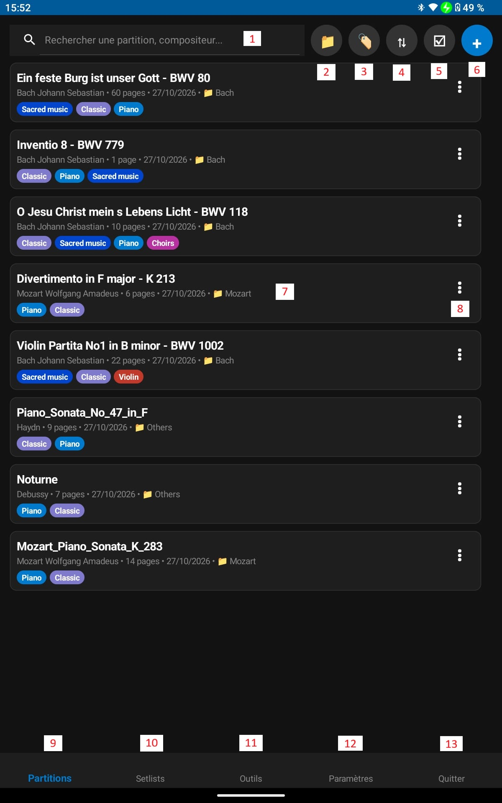
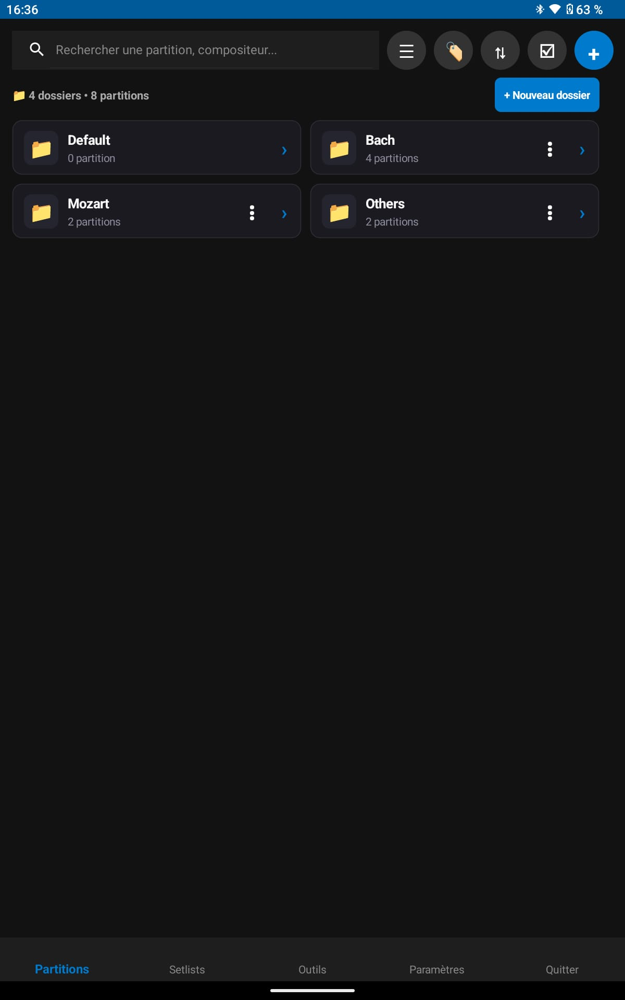
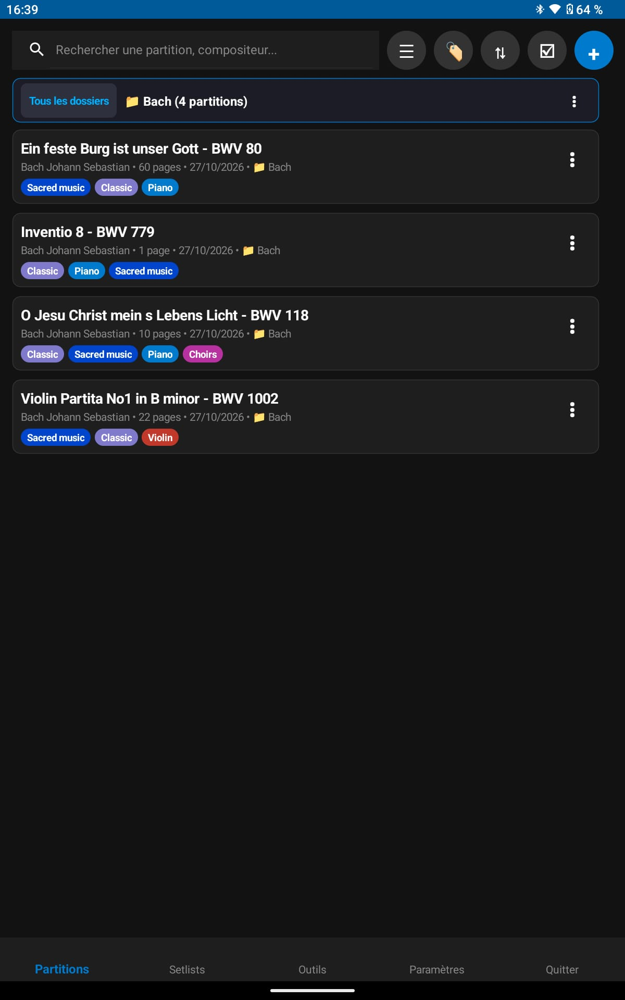
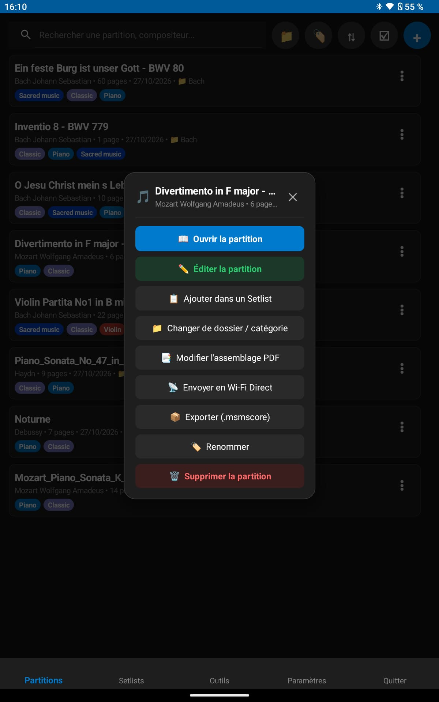
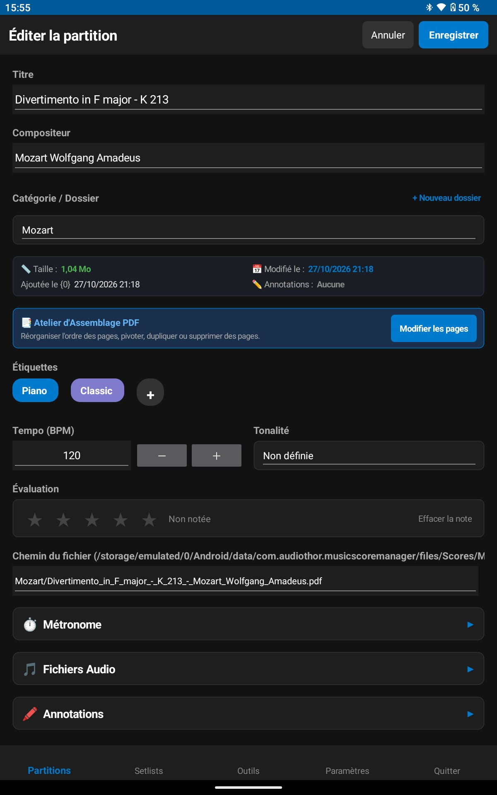

<h1 style="text-align: center;">Scores</h1>
<h2 style="text-align: center;">Home</h2>

The **Scores** menu is the primary gateway to your digital sheet music library. It displays all your scores in a responsive, modern card grid optimized for large tablets and phones alike.

  

---

## 1. Main Interface

This screen appears when you launch the application.
If you have never launched the app or imported scores, the application will inform you that you have no scores to display.

### A. Top of the screen — Essential Controls:

**[1] Real-time Search Bar**

- Type a few letters to instantly filter your library by **piece title**, **composer name**, or file name.
- Fast one-tap clear button to quickly return to your full catalog.

**[2] View Mode Toggle Button ("List" vs "Category / Folder")**

- **"List" Mode**:  
  Displays all sheet music in a large list. The details displayed for each score can be customized in settings.
- **"Category / Folder" Mode**:  
  Provides a "Folder" style view: allows organizing and creating categories on ONE level.  
  This management is complementary to using tags.  
  This feature is very convenient for organizing your scores, but is optional. In this mode, your PDF sheet music file is physically moved into a folder bearing your category name on device storage.  
  This view is appreciated by many musicians who prefer working with directories.  
  In this view, you can create a new folder, rename, or delete existing ones.  
  The default folder where scores are placed upon import is the "Default" folder. It cannot be renamed or deleted. A setting exists to assign another default directory, which is useful when importing many scores of the same category.  
  Deleting a folder automatically moves the contained scores back to the "Default" directory: no scores are ever lost or deleted.  
  Scores remain directly viewable and accessible from this view, with full access to the score context menu (⋮).

  
  

**[3] Tag Filter Button (🏷️)**

- Opens the tag selection modal with internal tag search and tag sorting (A-Z, Z-A, most/least used).
- Displays active filters in a horizontal carousel with color pills and quick-remove buttons.
- *« Clear all »* and *« Apply »* buttons.

**[4] Sort Order Selector (🔃)**

- Instantly reorders your library by:
  * **Date added (Newest first)**: Default sorting to easily find your latest imports.
  * **Date added (Oldest first)**.
  * **Title (A-Z) / Title (Z-A)**.
  * **Modification date (Recently edited)**.
  * **Rating (Highest rated)**: Pieces with 1 to 5 stars listed in descending order.
  * **Composer (A-Z)**: Alphabetical composer order. A dedicated toggle in *Settings > Scores* controls whether pieces without a composer appear at the very top or at the end.
  * **Untagged pieces first**: Prioritizes scores with no assigned tags so you can quickly organize them.
  * **Category (A-Z)**: Hierarchical sorting by folder category, then by score title.

**[5] Batch Multi-selection Button (☑️)**

- Activates bulk selection mode to perform operations across multiple scores simultaneously.
- Reveals an action bar at the bottom:
  * **🏷️ Assign tags**: Modal to simultaneously add or remove tags across all selected scores.
  * **📡 Share via Wi-Fi Direct**: Transmit the entire selected batch in one go over local wireless network.
  * **📦 Export (.msmscores)**: Generates a single compressed archive bundling all selected scores (with options to include annotations and audio backing tracks).
  * **🗑️ Delete**: Bulk deletion with security confirmation prompt.

> [!TIP]
> **Long-Press Shortcut**: If you long-press any score card for a couple of seconds in "List" or "Category" mode, multi-selection mode will activate automatically!

**[6] Add Score Button (➕)**: Allows adding sheet music:

- **PDF Import**: Strict binary integrity check preventing any crash. Batch import is supported (import multiple PDFs at once).
- **Photos / Images Import & Conversion**: Selecting image files (PNG, JPEG, GIF, WEBP, BMP) displays an informational dialog listing image files to be converted to PDF:
  * **Cancel**: Images are ignored. Any accompanying PDF files continue normal import.
  * **Continue**: A blocking loading overlay with progress status informs you during high-definition PDF conversion. Images are merged into a single multi-page PDF or created as individual scores according to your choice, followed by a completion confirmation once done.
- **Import Storage Modes**:
  * **Copy to app library (Recommended)**:  
    The PDF file is copied into Music Score Manager's dedicated internal storage. Your scores remain accessible at all times even if the original file is moved or deleted from the Downloads folder.
  * **Link original file (External)**:  
    The application stores the absolute file path without duplicating it to save storage space (indicated by a `🔗` badge).
- **"Don't ask again and remember my choice" (v3.2.8)**:  
  To avoid being prompted every time, you can configure your default import mode in score settings, or check the box **« Don't ask again and remember my choice »** directly in the import dialog!

### B. Middle of the screen — Score Library List

- **[6] The Score Card**:

Each score is represented by a visual card:
  - a. **Main piece title**.
  - b. **Customizable subtitle** (configurable in settings: composer, date added, page count, category...).
  - c. **Color-coded tag badges** to identify categories at a glance.
  - **🔗 External file badge** if stored outside internal storage.
  - **⚠️ Red warning badge (!) and red title**:  
    If the PDF file was moved, renamed, or is missing on storage, a bright red warning badge appears to the left of the ⋮ button to alert you that it cannot be opened in concert.

- **[7] Context menu**:  
  Access to the score context menu (see Section 2 below).

### C. Bottom of the screen — Main Application Menus

- **[8] Scores**: Current menu, highlighted in bold when active.
- **[9] Setlists**: Manages concert programs and live performance setlists.  
  => [See the Setlists Chapter](setlists.en.md)
- **[10] Tools**: Specialized utility studio (conversions, scanner, backups, tag management, P2P...).  
  => [See the Tools Chapter](tools.en.md)
- **[11] Settings**: All settings for the app, scores, setlists, foot pedals, etc.  
  => [See the Settings Chapter](settings.en.md)
- **[12] Quit**: Clean and safe application exit.  
  => [See the Quit Chapter](quit.en.md)

---

## 2. Score Context Menu ( ⋮ )

Tapping the **⋮** button on any score card opens a modern, ergonomic card:

  

1. **📖 Open score**:
   - Immediately opens the score in the fullscreen stage viewer (concert mode).

2. **✏️ Edit score**:
   - Opens the detailed metadata editing page:

  

   * **Title** and **Composer / Arranger**.
   * **Folder / Category** assigned to this score.
   * **Technical details**: File path, file size, modification date, date added, and indicator if annotations exist. Includes a button to re-link the file if moved.
   * **PDF Assembler Studio**: Direct link to perform page operations on your PDF file.
   * **Tags**: Dynamic selection (create tags in Tools or Settings).
   * **Reference Tempo (BPM)**: Initial value for the metronome.
   * **Musical Key** (classical *Do, Ré, Mi...* and international *A, B, C...*).
   * **Rating (1 to 5 stars)**: Personal rating.
   * **Full PDF file path** for reference.
   * **Metronome Accordion**: Time signature (2/4, 3/4, 4/4, 6/8...), subdivision, pre-count measures, and default mute/sound toggle.
   * **Audio Tracks Accordion**: Link backing audio files (MP3, WAV, etc.), preview playback, and relative volume adjustment.
   * **Annotation Options Accordion**:
     - Choose whether annotations are shown by default for this score.
     - Choose whether page numbers are displayed for this score.
     - Choose whether the toolbox button appears in the top-right corner.
   
   *DO NOT FORGET TO SAVE YOUR CHANGES!*

3. **📋 Add to Setlist**:
   - Inserts the score immediately into the chosen setlist.
   - **High-priority 1st position placement** (shifts other songs down).
   - Handles locked setlists.

4. **📁 Change folder / category**:
   - Move the score to another folder or create a new category on the fly.

5. **📑 Modify PDF assembly**:
   - Opens the piece directly in the **PDF Assembler Studio** to rearrange pages, insert blank sheets, rotate pages, or delete unnecessary sheets. Very convenient when your PDF is poorly arranged.
   - Also directly accessible from the "Tools" menu.

6. **📡 Send via Wi-Fi Direct**:
   - Opens the sharing options modal asking you to choose:
     * ☑️ *Include handwritten annotations*.
     * ☑️ *Include attached audio tracks* (MP3/WAV).
   - Starts immediate search for nearby devices via Wi-Fi Direct P2P.
   - The recipient simply goes to "Tools" > "Wi-Fi Direct Transfer" and clicks "Activate Reception".
   - The score is transferred and added directly into the recipient's library within seconds!

7. **📦 Export score (.msmscore)**:
   - Generates a standalone, transportable archive file with selectable export options (annotations, audio tracks).

8. **🏷️ Rename score**:
   - Quick dialog to change the title of the displayed PDF without opening the full editor.

9. **🗑️ Delete score**:
   - Removes the piece from your library with a secure confirmation prompt.
