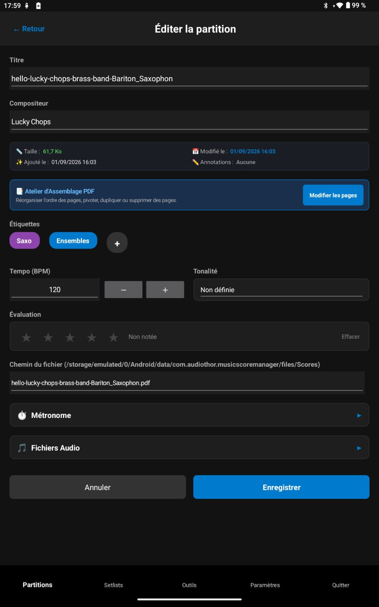

<h1 style="text-align: center;">Partitions</h1>
<h2 style="text-align: center;">Edition</h2>

L'édition d'une partition ne modifie pas le pdf en lui même mais les détails de la partition sélectionnée.
Ces informations ne seront présentes que dans ce logiciel **Music Score Manager** mais ne toucheront pas votre PDF.

  

--- 

* **Titre** : Le titre de votre morceau tel qu'il sera affiché dans l'application (espaces autorisés).

* **Compositeur / Arrangeur** : Cette information peut être affichée sur la page principale des partitions et sert pour le tri alphabétique.

* **Dossier / Catégorie** : Permet de classer la partition dans un répertoire thématique (par défaut "Général") ou d'en créer un nouveau directement avec le bouton `➕`. Le fichier est automatiquement déplacé sur le disque sans rompre aucun lien dans vos setlists.

* **Informations techniques** : taille, date de modification, date d'ajout et indication si des annotations ont été faites ou non sur cette partition. A noter la présence d'un bouton pour réassigner le fichier en cas de déplacement externe.
  
- **Atelier d'assemblage PDF** : Vous permet de restructurer votre fichier PDF en lui appliquant des rotations de pages, changer l'ordre, insérer des pages blanches, etc.
  Une aide plus précise est disponible pour expliquer cela dans le chapitre "Outils".

* **Étiquettes (tags)** : Pour assigner une ou plusieurs étiquettes à votre partition (Pour créer des étiquettes, se rendre dans les Outils). Cela s'avère très pratique ensuite pour trier et rechercher des partitions

* **Tempo de référence (BPM)** : C'est une valeur qui pourra être utiliser pour travailler vote partition (il défini le tempo sur lequel vous pourrez travailler par la vue du métronome ou l'écoute)

* **Tonalité musicale** : (solfège classique *Do, Ré, Mi...* et international *A, B, C...*).

* **Evaluation (1 à 5 étoiles)** : vous sert à donner une note à votre partition (plus facile à retrouver ensuite lros du filtre de tri)

* **Métronome** : options données au métronome  avec une ouverture de celui à l'ouverture de votre partition avec une activation du son du métronome ou pas.partition.

* **Pistes audio** : association de fichiers audio d'accompagnement (MP3, WAV, etc.), pré-écoute et réglage du volume.
  L'ajout de ces fichiers vous permettra de les jouer pendant l'affichage de votre partition (idéal pour completer avec d'autres voix que votre instrument)

En cas de modifications, n'oubliez pas de cliquer sur le bouton 'Enregistrer' pour sauvegarder vos modifications !
