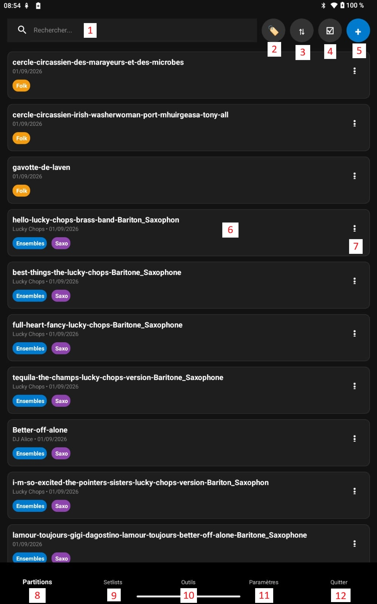
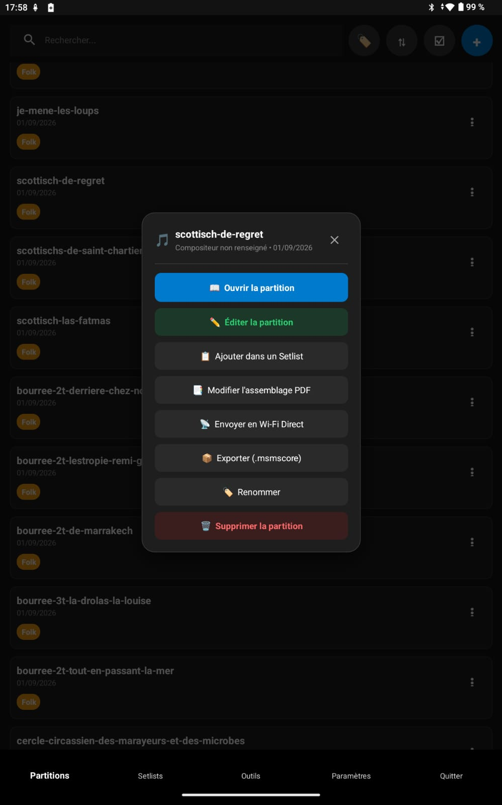

<h1 style="text-align: center;">Partitions</h1>
<h2 style="text-align: center;">Accueil</h2>

Le menu **Partitions** constitue la porte d'entrée de votre bibliothèque musicale. Il regroupe l'ensemble de vos partitions sous forme d'une grille de cartes modernes, réactives et optimisées pour les grands écrans comme pour les smartphones.

  

---

## 1. Interface principale

Cet écran s'affiche lorsque vous lancez l'application.
Si vous n'avez jamais lancé et donc importé de partitions, l'application vous signifiera que vous n'avez pas de partition à afficher.

### A. Partie haute de l'écran  - commandes essentielles :

**[1] Barre de Recherche en Temps Réel**

- Saisissez quelques lettres pour filtrer instantanément la liste par **titre de partition**, **nom de compositeur** ou nom de fichier.
- Effacement rapide d'une touche pour retrouver la vue intégrale.

**[2] Bouton de Bascule d'Affichage (📁 Mode Dossiers / Liste)**

- Permet d'alterner instantanément entre la **Vue en Liste classique** et la **Vue Dossiers / Catégories** :
  - **Vue Dossiers (Organisation thématique)** : affiche vos répertoires sous forme de cartes d'aperçu rapides avec le nombre exact de morceaux. Un clic sur un dossier ouvre son contenu en *drill-down* ultra-rapide avec barre de navigation / fil d'Ariane `[ ⬅ Tous les dossiers ]`.
  - **Menu contextuel de dossier** : permet de renommer le dossier, le vider ou le supprimer (les partitions sont rapatriées en toute sécurité dans le dossier "Général").
  - **Création instantanée** : bouton `[ ➕ Nouveau dossier ]` pour créer une nouvelle catégorie à la volée.
  - Les partitions sont également réparties physiquement sur votre disque dans des sous-répertoires au nom de chaque catégorie.

**[3] Bouton de Filtrage par Étiquettes (🏷️)**

- Ouvre le volet de sélection des tags avec recherche interne et tri des tags (A-Z, Z-A, les plus/moins utilisés).
- Affiche les étiquettes actives sous forme de carrousel horizontal avec pastilles de couleur et boutons de retrait rapide.
- Boutons *« Tout effacer »* et *« Appliquer »*.

**[4] Bouton de Tri Rapide (⇅)**

- Permet de réordonner instantanément votre bibliothèque selon :
  * **Date d'ajout (Plus récent d'abord)** : tri par défaut pour repérer immédiatement vos derniers imports.
  * **Date d'ajout (Plus ancien d'abord)**.
  * **Titre (A-Z) / Titre (Z-A)**.
  * **Date de modification (Plus récent)**.
  * **Évaluation (Meilleures notes)** : vos partitions notées de 1 à 5 étoiles classées par ordre décroissant.
  * **Compositeur (A-Z)** : ordre alphabétique des compositeurs. Un paramètre dédié dans *Paramètres > Partitions* permet de choisir si les partitions sans compositeur renseigné apparaissent au tout début ou à la fin.
  * **Sans étiquette d'abord** : place en tête les partitions qui n'ont encore aucun tag assigné pour vous aider à les classer facilement.

**[5] Bouton Multi-sélection (☑️)**

- Active le mode de sélection par lots pour appliquer des actions sur plusieurs partitions à la fois.
- Affiche une barre d'actions en bas de l'écran :
  - **🗑️ Supprimer** : suppression groupée avec confirmation de sécurité.
  - **📁 Dossier** : modale moderne pour déplacer ou réassigner simultanément les partitions cochées vers un dossier existant ou nouveau.
  - **🏷️ Assigner des étiquettes** : modale pour ajouter ou remplacer simultanément des tags sur toutes les partitions cochées.
  - **📦 Exporter (.msmscores)** : génère une archive compressée unique regroupant tous les fichiers choisis (avec choix des annotations et des pistes audio).
  - **📡 Partager en Wi-Fi Direct** : transmettez tout le paquet sélectionné en une seule fois sans fil.

**[6] Bouton Ajouter (➕)**

- **Importation contextuelle directe** : si vous êtes actuellement dans un dossier spécifique, les nouveaux fichiers importés y sont directement enregistrés sans étape intermédiaire.
- **Importation de PDF** : Contrôle strict de l'intégrité binaire (`%PDF-`) empêchant tout plantage. L'import peut se faire par lot (plusieurs PDF importés en une seule fois).
- **Importation et conversion d'Images** : La sélection d'un ou plusieurs fichiers images (PNG, JPEG, GIF, WEBP, BMP) affiche un message d'information listant les fichiers images qui vont être convertis en PDF :
  * **Annuler** : Les images sont ignorées. Les éventuels PDF sélectionnés en même temps continuent leur import normal.
  * **Continuer** : Une boîte de chargement modale avec indicateur d'avancement informe l'utilisateur pendant la conversion en PDF haute netteté. Les images sont fusionnées en un seul PDF multi-pages ou converties en partitions individuelles selon le choix de l'utilisateur, puis une confirmation s'affiche dès l'import terminé.
- Lors de l'ajout de partitions depuis votre appareil, l'application propose deux modes de gestion :
  - **Copier vers la bibliothèque (Conseillé)** :  
    Le fichier PDF est copié dans le dossier interne dédié de Music Score Manager. Vos partitions restent accessibles en permanence même si le fichier original est déplacé ou supprimé de son dossier de téléchargement.
  - **Lier le fichier original (Externe)** :  
    L'application conserve le chemin d'accès absolu vers le fichier sans le dupliquer pour économiser l'espace mémoire (signalé par un badge `🔗`).

### B. Milieu de l'écran - liste des partitions référencées dans l'application

- **[7] : La partition**

Chaque partition est représentée par une carte visuelle comprenant :

  a. **Titre principal de l'œuvre**.

  b. **Sous-titre personnalisable** (configurable dans les paramètres : compositeur, date d'ajout, nombre de pages ou dossier / catégorie `📁 [NomDossier]`).

  c. **Pastilles d'étiquettes colorées** pour repérer les catégories au premier coup d'œil.

  **🔗 Pastille de liaison externe** si le fichier est stocké hors du dossier interne.

  **⚠️ Pastille d'alerte rouge (!) et Titre rouge** :  
Si le fichier PDF associé a été déplacé, renommé sur le stockage ou est introuvable, une pastille rouge d'avertissement avec point d'exclamation apparaît à gauche du bouton ⋮ pour vous prévenir qu'elle ne pourra pas s'ouvrir en concert.

- **Index Alphabétique Rapide (A-Z)** :
  - Sur le bord droit de la liste, une réglette verticale alphabétique permet de sauter d'un seul toucher directement à la lettre souhaitée.
- **Bouton Flottant Haut de Page (▲)** :
  - Permet de remonter instantanément au début de la liste après un long défilement.

- **[8] : Menu contextuel**
  Accès au menu contextuel d'une partition (voir le chapitre § 2 ci-dessous)

### C. Bas de l'écran - menus principaux de l'application

- **[9] Partitions** : Le menu actuel, mis en valeur quand vous êtes dans ce menu.
- **[10] Setlists** : Gère les groupements de morceaux pour concert ou répétition (voir chapitre Setlists).
- **[11] Outils** : Utilitaires spécialisés (Scanner de partitions, Assemblage PDF, Wi-Fi Direct, Étiquettes, Sauvegardes...).
- **[12] Paramètres** : Personnalisation complète de l'application, des partitions, de l'affichage et des pédaliers.
- **[13] Quitter** : Fermeture propre et sécurisée de l'application.

---

## 2. Menu Contextuel d'une Partition ( ⋮ )

En cliquant sur le bouton **⋮** d'une carte de partition, une carte moderne et ergonomique s'affiche :

  

1. **📖 Ouvrir la partition** :
   - Ouvre immédiatement la partition dans le visualiseur plein écran (mode concert).

2. **✏️ Éditer la partition** :
   - Ouvre la page d'édition détaillée ([`ScoreEditPage`](file:///c:/Users/comme/Documents/GitHub/MusicScoreManager/ScoreEditPage.xaml)) :
     * **Titre** et **Compositeur / Arrangeur**.
     * **Dossier / Catégorie** (avec création à la volée `➕`).
     * **Tonalité musicale** (solfège classique *Do, Ré, Mi...* et international *A, B, C...*).
     * **Tempo de référence (BPM)** : valeur initiale pour le métronome.
     * **Note (1 à 5 étoiles)**.
     * **Étiquettes (tags)** : sélection dynamique.
     * **Accordéon Métronome** : chiffrage de mesure (2/4, 3/4, 4/4, 6/8...), subdivision, pré-compte et coupure/activation du son par défaut.
     * **Accordéon Pistes audio** : association de fichiers audio d'accompagnement (MP3, WAV, etc.), pré-écoute et réglage du volume.
     * **Informations techniques** : chemin d'accès, taille, date de modification, date d'ajout et présence d'annotations.

3. **📋 Ajouter dans un Setlist** :
   - Permet d'insérer instantanément la partition dans la setlist de votre choix (position prioritaire en tête de programme).

4. **📁 Changer de dossier / catégorie** :
   - Ouvre la modale stylisée avec halo lumineux `📁` pour déplacer instantanément la partition vers un autre dossier existant ou en créer un nouveau.

5. **📑 Modifier l'assemblage PDF** :
   - Ouvre la partition directement dans l'**Atelier d'Assemblage PDF** pour réorganiser les pages, insérer une page blanche, supprimer des pages inutiles ou effectuer des rotations.

6. **📡 Envoyer en Wi-Fi Direct** :
   - Ouvre une boîte modale d'options de partage (annotations, pistes audio) et recherche immédiatement les appareils à proximité en Wi-Fi Direct P2P.

7. **📦 Exporter la partition (.msmscore)** :
   - Génère une archive autonome transportable avec options d'export.

8. **🏷️ Renommer la partition** :
   - Boîte de dialogue rapide pour changer le titre affiché sans entrer dans l'édition complète.

9. **🗑️ Supprimer la partition** :
   - Supprime la partition de votre bibliothèque avec demande de confirmation sécurisée.
