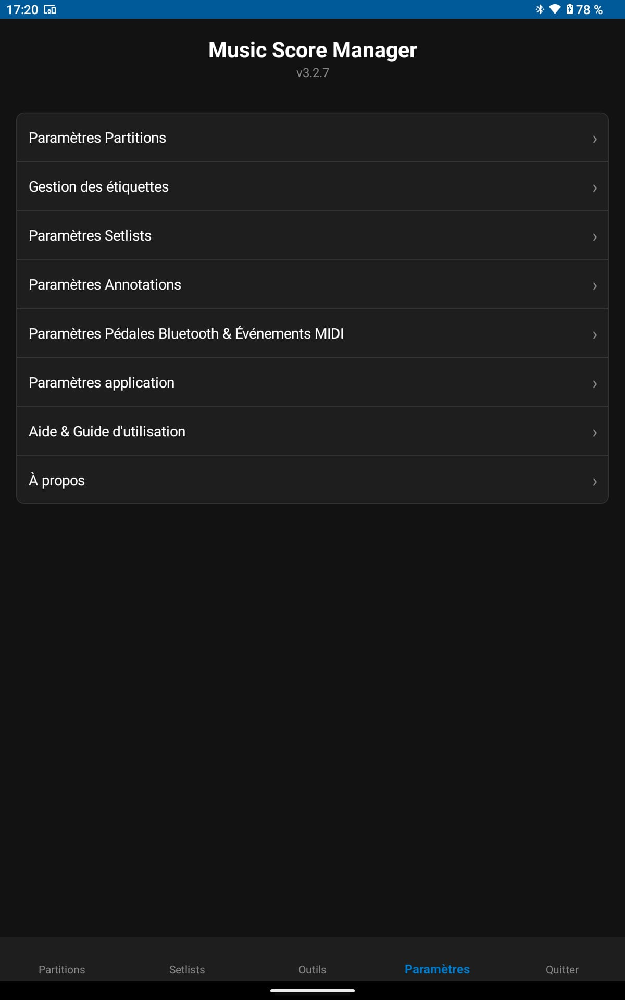

<h1 style="text-align: center;">Settings</h1>

The **Settings** menu allows you to tailor Music Score Manager specifically to your playing habits, your instrument, and your screen size.

  

---

## 1. Score Settings

This page configures the global behavior of your sheet music library:

**GENERAL**

- **Default sort on launch**:  
  Set which sort order applies automatically when opening the app (*Date added newest / oldest, Title A-Z / Z-A, Modification date, Star rating, Composer A-Z, Untagged first, or Category*).

- **Default score view mode**:  
  Choose whether scores are displayed by default in "List" mode or "Category / Folder" mode.

- **Default import mode**:  
  Configure your preferred file handling when adding new scores: local copy to library, link to external file, or prompt every time.

- **Default folder / category**:  
  Defines the destination folder used by default during score imports. We recommend using `"Default"`.

- **Scores without composer first (Toggle On/Off)**:  
  When sorting by composer, choose whether pieces with no composer specified appear at the very beginning (On) or at the end of the alphabetical list (Off, default behavior).

**DISPLAY**

- **Information displayed under score title**:  
  Customize and reorder the metadata displayed below each title in the library via **drag-and-drop** or ▲ / ▼ buttons (*Date added*, *Composer*, *Page count*, *Category*), with individual checkboxes and a live preview card.

- **Fast alphabetical index**:  
  Displays a vertical A-Z strip along the edge of the scores view to quickly jump to any section of your library.

- **Floating Scroll-to-Top button**:  
  Convenient circular button to return instantly to the top of your score catalog.

- **Current page number display (Toggle On/Off)**:  
  Shows or hides the discreet bottom-right page indicator (e.g. *Page 3 / 12*) while playing.

- **Show toolbox icon in top-right corner**:  
  Displays or hides the `[ 🛠️ ]` icon at the top right of the score viewer for easier visual identification.

- **Show score title at top**:  
  Displays a subtle top banner showing the current piece title in the viewer if you need to reference the file name while playing.

- **2-page landscape display (Toggle On/Off)**:  
  On tablets or wide screens in horizontal orientation, displays two consecutive pages side-by-side with geometric annotation synchronization and proportional scaling.

- **Keep screen awake while reading (Toggle On/Off)**:  
  Prevents the device display from dimming or sleeping while viewing a score.

- **Fullscreen immersive mode (Toggle On/Off, enabled by default)**:  
  Hides the system status bar (time, battery, notifications) and bottom navigation bar for a clean, distraction-free display utilizing 100% of the physical screen.  
  *Temporary system access:* quickly swipe from the top or bottom edge of the screen to reveal semi-transparent system bars for ~3 seconds before they hide automatically.

- **Page number font size**:  
  Adjustable slider from **10 px to 40 px** with live size preview to calibrate readability to your music stand distance. Default is 14 px.

**ERGONOMICS**

- **Ergonomic page turn gestures**:  
  - *Turn to next page*: Swipe left, Tap right, or Swipe up.  
  - *Turn to previous page*: Swipe right, Tap left, or Swipe down.

---

## 2. Tag Management

This page gives you complete control over your library classification:

- **Create a new tag** with a custom label (e.g., *Choir*, *Sight Reading*, *Christmas Concert*, *Acoustic Guitar*).
- **Vibrant color palette & RGB sliders**: assign a unique colored pill to each tag with real-time preview for instant visual identification in the scores list.
- **Edit or rename** any existing tag.
- **Delete a tag**: safely removes the tag from the application without altering or deleting the scores that had it assigned.

---

## 3. Setlist Settings

This page configures live performance behaviors:

**ORGANIZATION**

- **Default setlist sorting**:  
  Sets the sort order applied when viewing your setlists list.
- **Place completed setlists at bottom**:  
  Keeps archived and past concerts out of the way so active programs stand out.

**DEFAULT BEHAVIOR**

- **Continuous reading by default (Toggle On/Off)**:  
  Defines whether newly created setlists automatically transition to the next piece when turning past the final page of a score.
- **Return to setlist on score end**:  
  If continuous reading is disabled, turning past the last page exits the viewer and returns to the setlist overview.
- **Show live setlist progress drawer (Toggle On/Off)**:  
  Enables or disables sliding down the progress tracking drawer when tapping the top-center edge of the screen (enabled by default).

---

## 4. Annotation Settings

These settings configure the drawing and sticker tools inside the score viewer:

- **Custom Favorite Stickers**:  
  Input field to create personalized text stickers (e.g., *Vibrato*, *Watch Conductor*, *Solo*, *Breathe*, *Intro Hélène*...).  
  List of your active favorites with single-tap deletion `✕` and custom ordering.  
  Make sure to enable the "Favorites" category in the sticker category selector.
- **Sticker Category Selection**:  
  Check or uncheck the categories of stickers you want displayed in the annotations drawer (*Favorites, Fingerings, Dynamics, Articulations, Repeats, Notes, Rests, Accidentals, Symbols*).

---

## 5. Bluetooth Pedals & MIDI Controller Settings

Hands-free reading is essential during rehearsals and live stage performances. Music Score Manager integrates a universal engine compatible with both **Bluetooth foot pedals (HID)** and **MIDI controllers (USB-OTG and Bluetooth BLE)**, while protecting the musician against accidental double-presses.

---

#### A. Supported Devices & Connections

* **Bluetooth HID Pedals (Keyboard Mode):**  
  Compatible with all major market pedals: *AirTurn (Duo 500, Quad, PEDpro)*, *PageFlip (Dragonfly, Firefly, Butterfly)*, *Donner*, *Joyo*, *Thomann / Harley Benton*, *IK Multimedia iRig BlueTurn*, *Coda STOMP*, etc. Simply pair the pedal in your tablet's Bluetooth settings.  
  <u>If the default pedal actions do not suit your playing style, you can fully customize every button!</u>

* **MIDI Controllers & Pedals (USB-OTG & Bluetooth BLE):**  
  Direct driver-free connection via USB-OTG adapter (Boss, Behringer FCB1010, Morningstar, Line 6 Helix, etc.) or wireless Bluetooth MIDI adapter.  
  Native message interception:
  - **Control Change (CC)**: Standard sustain pedal (`CC 64`), `CC 66`, or any custom CC from 0 to 127.
  - **MIDI Notes**: Trigger actions from a synthesizer key or bass pedal note.
  - **Program Change (PC)**: Automatic song synchronization with your multi-effects units or keyboards.

---

#### B. Pedal Profiles Management

To adapt to your diverse performance settings (classical orchestra, rock band, solo piano), the app uses an interchangeable profiles architecture:

* **Default Active Profile:** The profile selected in general settings applies automatically across the entire library.
* **Built-in Factory Profiles:** Pre-configured profiles are included for leading market models (Dragonfly 4 pedals, Duo 2 pedals, standard Arrow keys, etc.). You can modify them as you wish!
* **Unlimited Custom Profiles:** Create, name, duplicate, and modify as many profiles as you need.
* **⭐ Dedicated Profile per Setlist:** You can link a specific pedal profile to a given setlist (from the setlist editor). During that concert, this profile takes absolute priority, and the default profile is restored automatically upon exiting the viewer.

---

#### C. Button Configuration & Auto-Learn Mode

The profile editor ("Edit selected profile") lets you map pedals in seconds using live signal learning:

1. **Assign a profile name** or keep the default name.
2. **Add a description** (optional).
3. **Add pedal buttons:**  
   Give each pedal a name (e.g., "Right pedal", "Sustain switch"...).
   - **Automatic Signal Detection ("Listening" mode):**  
     Press the physical pedal or send the MIDI command: the app instantly captures the signal, detects its type (HID Keyboard, CC, MIDI Note), and displays its exact code.
   - **Short Press (⚡) vs Long Press (⏱️):**  
     Each physical pedal can trigger **two different actions** based on hold duration (e.g.: *Short press = Next page*, *Long press = Next song in setlist*).
   - **Assignable Actions Catalog:**  
     - **Navigation & Page Turns:** Next / Previous page, Scroll up / down, First / Last page, Next / Previous song in setlist.
     - **Stage Tools & Timing:** Start / stop metronome, Mute / unmute metronome click, Play / pause audio backing track, Restart song.
     - **Display & Reading:** Next / Previous bookmark marker, Zoom in / out / reset 100%, Night Mode (color inversion).
     - **Annotations:** Lock / unlock drawing layer, Hide / show annotations, Undo / Redo last stroke.

   *DO NOT FORGET TO SAVE YOUR PROFILE!*

4. **Repeat for your other pedal switches!**

---

#### D. Stage Safety & Debounce Protection

To guarantee complete peace of mind during live performances:

* **Anti-Double Jump Protection:** Eliminates mechanical switch bounces or nervous double taps. The app ignores closely spaced taps using an adjustable debounce delay (from 200 ms to 800 ms).
* **Long-Press Sensitivity:** A calibration slider (200 ms to 1000 ms) lets you set the exact hold duration required to trigger secondary actions without false positives.

---

#### E. Android Practical Tip (Virtual Keyboard)

> 💡 **Tip for Bluetooth HID Pedals:**  
> When a pedal is connected via Bluetooth, Android recognizes it as a physical hardware keyboard and may hide the on-screen virtual keyboard.  
> To continue typing text annotations or searching for pieces:  
> Go to Android tablet settings > **System** > **Languages & input** > **Physical keyboard**, and enable **« Show virtual keyboard on screen »**.

---

## 6. Application Settings (General)

This page manages global application preferences and system environment:

**LANGUAGE**

- **🌐 Interface Language Selector**:  
  Interactive modal offering **8 built-in languages**:  
  * 🇫🇷 **Français**, 🇬🇧 **English**, 🇩🇪 **Deutsch**, 🇪🇸 **Español**, 🇮🇹 **Italiano**, 🇵🇱 **Polski**, 🇳🇱 **Nederlands**, 🇵🇹 **Português**.  
  Dynamic instant translation across the entire interface without restarting the app.  
  *Note:* The default language matches your tablet's operating system language. If unsupported, English is selected automatically.

**APPLICATION BEHAVIOR**

- **Show "Quit" menu**:  
  Shows or hides the "Quit" tab in the bottom navigation bar.
- **Confirm before quitting**:  
  Asks for confirmation before exiting the application.

**LIBRARY (Statistics)**

- **📊 Library Statistics & Storage Metrics**:  
  - **Total number of PDF scores** saved.
  - **Total disk space occupied** by PDF scores (in MB).
  - **Available storage space**: Remaining free capacity on device (in GB).
  - **Database file size**: Storage occupied by SQLite (`scores.db3` + WAL/SHM journals).

- **📁 Customizable Directory Locations**:  
  - Root scores folder, audio tracks folder, and exports folder.
  - Supports public Android storage directories for easy USB cable file transfers to a PC.

---

## 7. Built-in Help

This page includes offline quick help guides and stage advice:
- Quick start tutorial.
- Link to the complete documentation (available in French and English).
- Discord community link to report bugs, suggest features, or say thanks!

---

## 8. About

This page provides legal, copyright, and technical information:
- Dynamic version number.
- Author.
- Open-source license: **GNU General Public License v3.0 (GPLv3)**.
- Comprehensive list of open-source frameworks used (.NET MAUI, CommunityToolkit & MediaElement, SQLite, Mozilla PDF.js, Plugin.Maui.Audio, SixLabors.ImageSharp).
- Direct links to GitHub source code and Privacy Policy.
- Discord community link.
