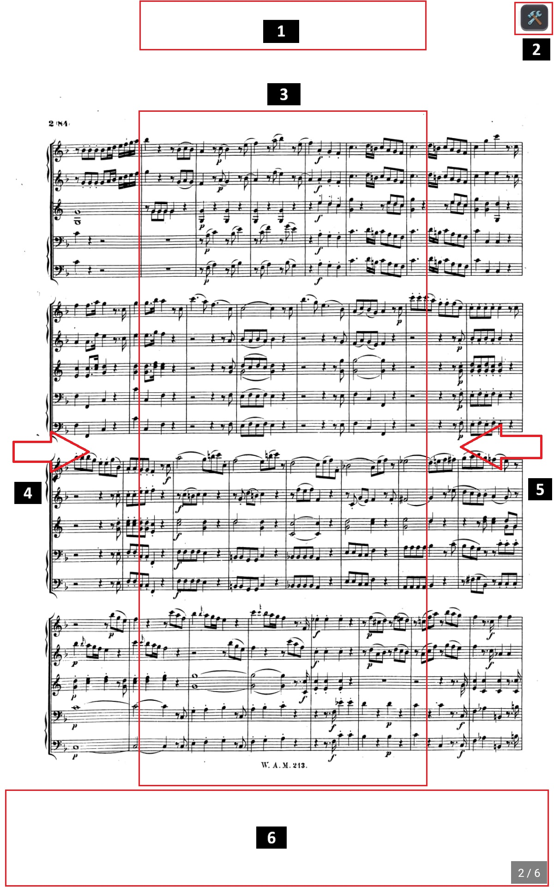

<h1 style="text-align: center;">Scores</h1>
<h2 style="text-align: center;">Fullscreen Stage Viewer (Stage Mode)</h2>

The **Stage Viewer** is where your music comes to life. Designed to eliminate every visual distraction, it provides maximum legibility, ultra-fluid synchronous rendering, and lightning-fast touch gestures.

  

---

## [1] Setlist Progress (Top)

Tap this zone once **only when viewing scores within a setlist** to open the "Setlist Progress" drawer.  
This allows you to situate the current piece within the overall concert program and jump directly to any piece.  
The "Completed", "In Progress", and "Upcoming" status indicators let you quickly jump between scores in live performance if any unforeseen program change occurs.

---

## [2] Quick Tools Drawer (Top-Right)

Tap the upper right corner of the screen (or the `[ 🛠️ ]` icon if enabled in settings) to open the **Quick Tools Drawer**. It lets you toggle live stage components on the fly without interrupting your performance:

1. **✍️ Annotations**: Shows or hides the annotation toolbar at the bottom of the screen.
2. **⏱️ Metronome**: Expands or collapses the synchronized visual and audio metronome.
3. **🎧 Audio Player**: Shows or hides the backing track playback bar.
4. **📄 Page Number**: Enables or disables the page indicator in the bottom-right corner.
5. **🎛️ Tuner**: Opens the high-precision floating multi-instrument tuner.
6. **🏷️ Score Title**: Shows or hides the top banner displaying the piece name.

All modifications apply instantly in real time on the score upon tapping each tile.

---

#### 1. Annotations

Allows showing or hiding all handwritten annotations on the page.  
A setting is available in the score editor to control this preference automatically upon opening the score.

---

#### 2. High-Precision Integrated Metronome

- **Thread-Safe Regulated Engine**: Zero CPU drift thanks to a dual `Stopwatch` + `SpinWait` loop.
- **Zero Audio Latency**: Samples triggered directly via native Android `SoundPool`.
- **Visual Pulse & LED**: Synchronized light flashing on downbeats and regular beats.
- **Mute Click Toggle**: Turn sound on or off on the fly while retaining visual cues.
- **Synchronized Pre-Count**: Pre-count measure countdown before audio playback begins.

The default metronome settings (BPM, time signature) can be configured in the score editor.

---

#### 3. Synchronized Audio Player (Backing Tracks & Playback)

- Full support for attached MP3, WAV, AAC, and FLAC audio files.
- Compact transport bar with Play/Pause button.
- Progress seek slider with elapsed and total duration display.
- Floating and freely draggable anywhere on screen.

Assigning audio files to a score is done in the score editing page.

---

#### 4. Page Number

Allows jumping directly to any specific page, and showing or hiding the page count badge in the bottom-right corner.  
Note that in score settings, you can toggle global page number display across all scores and adjust the default font size of the page number.

---

#### 5. High-Precision Multi-Instrument Tuner

Music Score Manager includes a professional stage tuner directly accessible during rehearsals or concerts without leaving your score:

- **Floating, Movable Window**:
  - Features a dedicated `⠿ Move` touch handle and smooth gesture detection: drag the tuner anywhere on screen so it never hides any important measure.
  - Fast close button `✕` in the top right corner.
- **Precision DSP Engine (YIN Algorithm)**:
  - **YIN Pitch Detection ($\theta = 0.15$)**: Cumulative normalized difference calculation $d'(\tau)$ for surgical precision with zero octave jumps or false harmonics.
  - **2-Pole Low-Pass Filter (1200 Hz)**: Eliminates breath noise, reed rattle, and guitar pick transients.
  - **Sub-Harmonic & Octave Correction**: Locks onto the real fundamental pitch even on instruments where the fundamental is masked by the 2nd or 3rd harmonic (saxophones, French horn, bassoon, oboe, cello, double bass).
  - **Median Filtering & Exponential Moving Average (EMA)**: Smooth, rock-solid cent needle without visual jitter ($\alpha = 0.45$).
- **Reference Pitch Calibration (A4 Frequency)**:
  - Finely adjustable base pitch: Baroque (415 Hz), Natural pitch (432 Hz), International Standard (440 Hz), Symphony Orchestra (442 Hz), and up to 444 Hz.
- **Extensive Instrument Library & Dedicated Presets**:
  - **Universal Chromatic Tuner**: Detects all notes in the equal-tempered scale with exact Hz frequency readout.
  - **Guitars & Basses**: Standard Guitar (E A D G B E), 4-String Bass (E A D G), 5-String Bass (B E A D G).
  - **Bowed & Folk Strings**: Violin (G D A E), Viola (C G D A), Cello (C G D A), Double Bass (E A D G), Ukulele (G C E A), 5-String Banjo (Open G).
  - **Saxophones (Full Quartet)**: Alto Sax (E♭), Tenor Sax (B♭), Baritone Sax (E♭), Soprano Sax (B♭).
  - **Brass & Concert Band**: Trumpet & Clarinet (B♭), French Horn (F), Trombone / Euphonium / Tuba (C - Bass Clef).
  - **Woodwinds**: Concert Flute (C), Oboe & Bassoon (C, with **Oboe A 440 Hz** as symphonic concert pitch reference).
  - **Vocals & Human Voice**: Tailored ranges and vocalises (Bass, Baritone, Tenor, Alto, Mezzo-Soprano, Soprano).
- **Intuitive Visual Gauge**:
  - Cent needle graduated from -50 to +50 cents with dynamic color-coding (Green = in tune, Amber/Red = flat or sharp).
  - Dual note naming (international *A, B, C...* and solfege *Do, Re, Mi...*), octave index, and frequency in Hz.

---

#### 6. Score Title

Allows showing or hiding the score title (derived from the PDF file name) at the top of the sheet music page.

---

## [3] Central Quick Menu (Double-Tap)

**Double-click or double-tap in the center of the screen** to display the quick action dialog without leaving your sheet music:

**Return to Home (Red button)**: Exits back to the previous menu (closing the active score or setlist stage view cleanly).

**Close Button (X)**: Closes this central action menu.

The piece title is clearly displayed underneath the header buttons.

1. **Page Bookmark**:
   Toggling this switch places a handy bookmark flag on the current page, which can be triggered via Bluetooth pedals or direct touch. Tapping a bookmark allows giving it a short 3-letter name, jumping to next/previous bookmarks, or removing it.
2. **↻ Rotate (+90°)**:
   - Rotates the score 90° clockwise.
   - **« Apply to this page only » toggle**: Rotates only an individual page scanned in landscape mode.
   - **« Remember rotations » toggle**: Saves the rotation permanently in the local database.
3. **🔍 Restore original size (100%)**:
   - Instantly resets zoom and perfectly reframes the page to fit the screen.
4. **✏️ Edit score**: Direct access to edit score metadata.
5. **📑 PDF Assembler**: Jump directly into the PDF Assembler Studio (see [Tools](tools.en.md)).

---

## [4] & [5] Stage Gestures & Navigation

- **Next Page**:
  - Tap the right half of the screen or swipe right-to-left (configurable in settings: horizontal swipe, one-tap, or vertical swipe).
- **Previous Page**:
  - Tap the left half of the screen or swipe left-to-right.
- **Continuous Setlist Progression**:
  - When reaching the last page of a score in a setlist, turning the page immediately opens the first page of the subsequent song.
- **Pinch-to-Zoom & Pan**:
  - Pinch two fingers to enlarge a stave or passage. You can pan freely across the sheet even while zoomed in.
- **Dual-Page Display in Landscape Mode**:
  - On horizontal tablets, enable two-page side-by-side mode in settings (like an open printed score book).
  - Annotations remain geometrically aligned on both left and right pages, accounting for letterbox/pillarbox margins.
- **Clickable Page Indicator**:
  - Page counter badge in the bottom-right corner (`e.g., 2/8`). Tapping it opens a direct jump dialog to navigate instantly to any page.
- **Immersive Fullscreen Mode (100% of Physical Screen)**:
  - System status bar (clock, battery, notifications) and bottom navigation bar are completely hidden to eliminate all stage distraction.
  - *Transient system access preserved*: A quick swipe inward from the top or bottom screen edge temporarily reveals transparent system bars for ~3 seconds. Configurable in *Settings > Scores*.

---

## [6] Annotation Toolbar

The annotation toolbar expands from the bottom of the screen and adapts to your workflow:

- **Dedicated Drag Handle (`⠿`)**:
  - Located on the far left, the `⠿` handle lets you slide the entire toolbar vertically without conflicting with the horizontal scrolling of pens and stickers.
- **Phone & Tablet Ergonomics**:
  - On smartphones, the `✕` close button is fixed on the far right so it remains easily clickable on any screen width.
- **🖌️ Highlighter**:
  - Natural translucent strokes with flat beveled caps (`PenLineCap.Flat`).
  - 4 neon colors (yellow, green, blue, pink) and 3 stroke widths (5 mm, 10 mm, 18 mm).
- **T Typographic Text**:
  - Direct text typing on the sheet music, with 6 colors and 5 font sizes.
- **✏️ Freehand Pen**:
  - 100% opaque lines, 6 colors, and 5 stroke widths calibrated from 1 mm to 5 mm.
- **❏ Musical Stickers & Favorites**:
  - Over 100 stickers organized into categories: Favorites, Fingerings, Dynamics, Articulations, Repeats, Notes (𝅝, 𝅗𝅥, ♩, ♪, ♫...), Rests (𝄻, 𝄼, 𝄽, 𝄾...), Accidentals (♯, ♭, ♮, 𝄪, 𝄫), and Symbols.
  - *Note: Your Favorites and visible sticker categories can be customized under Annotation Settings*.
  - Large touch-friendly slider to adjust sticker size on the fly.
- **↩️ Undo / ↪️ Redo**:
  - Complete dynamic undo/redo history stack for all drawing actions.
- **🔒/🔓 Security Lock**:
  - Automatic safety lock upon opening the toolbar to safeguard the score against accidental pen marks during concerts.
  - Unlocks automatically when selecting an editing tool.
  - Locks automatically upon closing the toolbar (`✕`).
- **✧ Clear Page**: Clears all annotations on the current page with confirmation prompt.
- **🗑️ Delete Selected**: Touch selection of an existing annotation to delete it with finger tap or double-tap.

---

## Don't Forget:

## Hands-Free Control: Bluetooth Foot Pedals & MIDI Events

Music Score Manager integrates a universal hardware control engine:

- **Bluetooth HID Pedals & Keyboards**: Full compatibility with AirTurn, PageFlip Dragonfly/Firefly, Joyo, Donner, Thomann/Harley Benton, IK Multimedia iRig BlueTurn, Coda STOMP, keyboard arrow keys, etc.
- **MIDI Controllers (USB-OTG & Bluetooth MIDI)**: Sustain pedals (CC 64), sostenuto (CC 66), soft pedal (CC 67), MIDI notes, and Program Changes.
- **Foot-Triggerable Actions** (configurable for short press or long press with adjustable debounce sensitivity from 200 to 1000 ms):
  - Next / previous page
  - Next / previous song in setlist
  - Start / end of score
  - Scroll up / down
  - Start / mute metronome sound and click
  - Play / Pause backing audio track
  - Reset zoom to 100%
  - Open page jump dialog
  - Lock / unlock annotations
  - Undo / Redo
  - Open central action menu / Exit stage viewer
