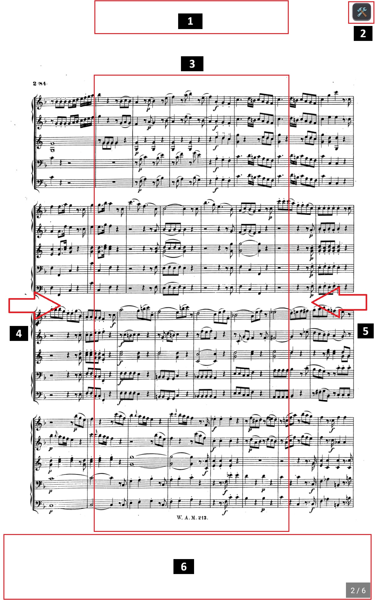

<h1 style="text-align: center;">Partitions</h1>
<h2 style="text-align: center;">Visualiseur plein écran (mode scène)</h2>

Le **Visualiseur** est l'espace où la musique prend vie. Conçu pour éliminer toute distraction visuelle, il offre une lisibilité maximale, un rendu synchrone ultra-fluide et des commandes gestuelles ultra-rapides.

  

---

## [1] Déroulement de Setlist (Haut)

Touchez une fois cette zone **uniquement lors d'une utilisation de partitions dans une setlist** et vous ouvrirez le "Déroulement de la setlist"
Cela permet de situer la partition actuelle dans le déroulement complet et d'accéder directement à l'une au l'autre directement.
Le status "Passé", "En cours" et "A venir" permet en plein concert de rapidement basculer d'une partition à l'autre en cas de modification non prévue du déroulement.

---

## [2] Tiroir des Outils Rapides (Haut-Droite)

Touchez le coin supérieur droit de l'écran (ou l'icône `[ 🛠️ ]` si elle est activée dans les paramètres) pour ouvrir le **Tiroir des Outils Rapides**. Il permet de basculer instantanément en direct les composants scéniques sans interrompre la lecture :

1. **✍️ Annotations** : Active ou masque la barre d'annotations en bas de l'écran.
2. **⏱️ Métronome** : Déploie ou replie le métronome synchronisé.
3. **🎧 Lecteur Audio** : Affiche ou masque la barre de lecture audio d'accompagnement.
4. **📄 Numéro de Page** : Active ou masque l'indicateur de page en bas à droite.
5. **🎛️ Accordeur** : Ouvre l'accordeur flottant multi-instruments haute précision.
6. **🏷️ Titre de la Partition** : Affiche ou masque le bandeau supérieur avec le nom du morceau.

Les modifications sont immédiatement réactives en temps réel sur la partition dès le clic sur une tuile.

---

#### 1. Annotations

Permet d'afficher ou non toutes les annotations de la page.
Un paramètre existe dans l'édition de la partition pour gérer ce paramètre dès l'ouverture de la partition.

---

#### 2. Métronome Haute Précision Intégré

- **Moteur Thread-Safe Régulé** : Zéro dérive CPU grâce à la double boucle `Stopwatch` + `SpinWait`.
- **Zéro Latence Audio** : Échantillons déclenchés via `SoundPool` natif Android.
- **Affichage Visuel & LED** : Pulsation lumineuse synchronisée sur les temps forts et temps faibles.
- **Coupure du Clic Sonore** : Possibilité d'activer ou de couper le son à la volée tout en conservant le repère visuel.
- **Pré-compte Synchronisé** : Décompte de mesures avant démarrage de la lecture audio.

Le réglage par défaut du métronome se fait dans l'édition de la partition.

---

#### 3. Lecteur Audio Synchronisé (Accompagnement & Playback)

- Prise en charge des fichiers MP3, WAV, AAC, FLAC rattachés.
- Barre de transport compacte avec bouton Lecture/Pause.
- Slider de progression avec affichage du temps écoulé et temps total.
- Amovible et déplaçable librement sur l'écran.

La définition des fichiers audio associés à une partition se fait dans la partie édition de la partition.

---

#### 4. Numéro de page

Permet de se rendre directement à une page précise, d'afficher ou non le numéro de page en bas à droite.
A noter que dans les paramètres de partitions, il est possible de définir l'affichage général dans toutes les partitions ou non et de définir la taille par défaut de l'affichage du nombre de pages.

---

#### 5. Accordeur Haute Précision Multi-Instruments (Tuner)

Music Score Manager intègre un accordeur de scène professionnel accessible directement pendant la répétition ou le concert sans quitter votre partition :

- **Boîte Flottante Amovible & Déplaçable** :
  - Équipée d'une poignée tactile dédiée `⠿ Déplacer` et d'une détection gestuelle fluide : glissez l'accordeur n'importe où sur l'écran pour ne masquer aucune mesure importante de votre partition.
  - Bouton de fermeture rapide `✕` en haut à droite.
- **Moteur DSP de Précision (Algorithme YIN)** :
  - **Détection YIN ($\theta = 0.15$)** : calcul de la différence au carré cumulée normalisée $d'(\tau)$ pour une précision chirurgicale sans sauts d'octaves ni fausses harmoniques.
  - **Filtre passe-bas 2 pôles (1200 Hz)** : élimine les bruits de souffle, le grésillement des anches d'instruments à vent et les attaques de médiator.
  - **Correction des sous-harmoniques & octaves** : verrouille la note fondamentale réelle même sur les instruments dont le fondamental est masqué par le 2ᵉ ou 3ᵉ harmonique (saxophones, cor, basson, hautbois, violoncelle, contrebasse).
  - **Filtrage médian & Lissage exponentiel (EMA)** : aiguille des cents ultra-stable et sans scintillement visuel ($\alpha = 0.45$).
- **Étalonnage du Diapason (Fréquence de Référence A4)** :
  - Référence réglable avec précision : Baroque (415 Hz), Diapason naturel (432 Hz), Standard international (440 Hz), Orchestre symphonique (442 Hz), et jusqu'à 444 Hz.
- **Large Palette d'Instruments & Presets Dédiés** :
  - **Accordeur Chromatique Universel** : détecte toutes les notes de la gamme tempérée avec affichage de la fréquence exacte en Hz.
  - **Guitares & Basses** : Guitare standard (E A D G B E), Basse 4 cordes (E A D G), Basse 5 cordes (B E A D G).
  - **Cordes Frottées & Traditionnelles** : Violon (G D A E), Alto (C G D A), Violoncelle (C G D A), Contrebasse (E A D G), Ukulélé (G C E A), Banjo 5 cordes (Open G).
  - **Saxophones (Quatuor complet)** : Saxophone Alto (Mi♭), Saxophone Ténor (Si♭), Saxophone Baryton (Mi♭), Saxophone Soprano (Si♭).
  - **Cuivres & Harmonies** : Trompette & Clarinette (Si♭), Cor d'harmonie (Fa), Trombone / Euphonium / Tuba (Ut - Clé de Fa).
  - **Bois** : Flûte traversière (Ut), Hautbois & Basson (Ut, avec le **La 440 Hz du Hautbois** comme référence symphonique).
  - **Chant & Voix humaine** : Tessitures et vocalises adaptées (Basse, Baryton, Ténor, Alto, Mezzo, Soprano).
- **Indicateur Visuel Intuitif** :
  - Cadran gradué de -50 à +50 cents avec code couleur dynamique (Vert = parfaitement accordé, Ambre/Rouge = trop bas ou trop haut).
  - Double affichage du nom de la note (international *A, B, C...* et solfège *Do, Ré, Mi...*), indice d'octave et fréquence en Hz.

---

#### 6. Titre de la partition

Permet d'afficher ou non le titre de la partition (ce qui correspond au nom du fichier PDF de la partition) au dessus de la page de partition.

---

## [3] Menu Central Rapide (Double-Tap)

Faites un **double-clic ou double-tap au centre de l'écran** pour afficher le menu d'actions rapides sans quitter votre partition :

**Retour à l'accueil** : Permet de revenir au menu précédent (permet donc de quitter l'affichage de la partition en cours ou de la setlsit en cours).
Sortie propre du visualiseur.

**La croix X** : Permet de fermer ce menu central

Le nom de la partition est affichée en dessous.

1. **Marqueur de page**
   En actionnant le bouton cela permet de positioner un petit marque page qui peut être utilise lors de commandes directes via une pédale bluetooth par exemple.
   Le marque page est éditable si on clique dessus. On peut lui donner un nom sur 3 lettres maximum et d'accéder au marque page suivant ou précédent si il existe.
   Il est aussi possible de la supprimer par ce petit menu.
   
2. **↻ Rotation (+90°)** :
   - Fait pivoter la partition de 90° dans le sens des aiguilles d'une montre.
   - **Option « Appliquer à cette page uniquement »** : permet de pivoter uniquement une page spécifique scannée en paysage.
   - **Interrupteur « Mémoriser les rotations »** : enregistre l'orientation dans la base de données locale.
3. **🔍 Rétablir la taille d'origine (100%)** :
   - Réinitialise immédiatement le zoom et recadre parfaitement la page sur l'écran.
4. ✏️ **Modifier la partition** : Accès direct à l'édition des métadonnées musicales.
5. **📑 Modifier l'assemblage PDF** : Bascule directement dans l'Atelier d'Assemblage PDF. (Cf voir [outils](tools.md))

---

## [4] et [5] Gestes & Navigation sur Scène

- **Tourner la page suivante** :
  - Tapez sur la moitié droite de l'écran ou glissez votre doigt de droite à gauche (configurable dans les paramètres : glissement horizontal, taper, ou glissement vertical).
- **Page précédente** :
  - Tapez sur la moitié gauche ou glissez de gauche à droite.
- **Enchaînement automatique dans une setlist** :
  - Lorsque vous atteignez la dernière page d'un morceau appartenant à une setlist, la tourne de page suivante ouvre instantanément le premier feuillet du morceau suivant.
- **Zoom tactile (Pinch-to-zoom) & Pan** :
  - Écartez deux doigts pour agrandir une portée ou une mesure. Vous pouvez déplacer la page librement même en zoomant.
- **Affichage 2 pages en mode paysage** :
  - Sur tablette en orientation horizontale, activez dans les paramètres l'affichage double-page côte à côte (comme un vrai recueil de partitions ouvert).
  - Les annotations sont synchronisées géométriquement avec une fidélité absolue sur la page de gauche et la page de droite en tenant compte des marges réelles (*letterbox/pillarbox*).
- **Indicateur de Page Cliquable** :
  - Badge de numérotation en bas à droite (`ex: 2/8`). Un clic ouvre la boîte de saut direct vers la page de votre choix.
- **Mode Plein Écran Immersif (100% de la surface physique)** :
  - Masquage complet de l'en-tête système (heure, batterie, notifications) et de la barre de navigation inférieure pour éliminer toute distraction sur scène.
  - *Accès système temporaire préservé* : un simple glissement rapide depuis le bord supérieur ou inférieur de l'écran fait réapparaître les barres système en transparence pendant ~3 secondes. Configurable dans *Paramètres > Partitions*.

---

## [6] Barre d'Annotations

La barre d'annotation se déploie depuis le bas de l'écran et s'adapte à vos mouvement.

- **Poignée de Déplacement Dédiée (`⠿`)** :
  - Située à gauche de la barre, la poignée `⠿` permet de faire glisser verticalement l'ensemble des outils d'annotation sur l'écran sans aucun conflit avec le défilement horizontal des crayons et stickers.
- **Adaptation Mobile & Tablettes** :
  - Sur smartphone, la croix de fermeture `✕` est ancrée de façon fixe à droite pour rester constamment cliquable quelle que soit la largeur d'écran.
- **🖌️ Surligneur Fluo (Stabilo)** :
  - Rendu translucide naturel à bords biseautés droits (`PenLineCap.Flat`).
  - 4 teintes fluo (jaune, vert, bleu, rose) et 3 largeurs (5 mm, 10 mm, 18 mm).
- **T Texte Typographié** :
  - Saisie textuelle directe sur la partition, 6 couleurs et 5 tailles de police.
- **✏️ Crayon à Main Levée** :
  - Tracé opaque à 100%, 6 couleurs et 5 épaisseurs de trait calibrées de 1 mm à 5 mm.
- **❏ Stickers Musicaux & Favoris** :
  - Plus de 100 stickers organisés par catégories : Favoris, Doigtés, Nuances, Articulations, Répétitions, Notes (𝅝, 𝅗𝅥, ♩, ♪, ♫...), Silences (𝄻, 𝄼, 𝄽, 𝄾...), Altérations (♯, ♭, ♮, 𝄪, 𝄫) et Symboles.
    *A noter que vos Favoris peuvent être définis dans les Paramètres Annotations de l'application ainsi que les catégories de stickers affichés ou non*
  - Réglette grand format ergonomique pour ajuster la taille du sticker au doigt.
- **↩️ Annuler (Undo) / ↪️ Rétablir (Redo)** :
  - Historique dynamique complet pour annuler ou rétablir chaque modification.
- **🔒/🔓 Cadenas de Verrouillage de Sécurité** :
  - Verrouillage automatique systématique à l'ouverture pour sanctuariser la partition contre toute fausse manipulation.
  - Déverrouillage automatique au choix d'un outil d'édition.
  - Re-verrouillage automatique à la fermeture de la barre (bouton ✕).
- **✧ Nettoyage Général** : Réinitialise toutes les annotations de la page avec confirmation de sécurité.
- **🗑️ Suppression Ciblée** : Sélection tactile d'une annotation existante pour la supprimer au doigt ou par double-tap.

---

## A ne pas oublier :

## Contrôle Mains-Libres : Pédaliers Bluetooth & Événements MIDI

Music Score Manager intègre un moteur de commande matérielle universel :

- **Pédaliers Bluetooth HID & Claviers** : Compatibilité totale avec AirTurn, PageFlip Dragonfly/Firefly, Joyo, Donner, Thomann/Harley Benton, IK Multimedia iRig BlueTurn, Coda STOMP, touches fléchées, etc.
- **Contrôleurs MIDI (USB-OTG & Bluetooth MIDI)** : Pédales sustain (CC 64), sostenuto (CC 66), soft pedal (CC 67), notes MIDI et Program Changes.
- **Actions Déclenchables au Pied** (au choix sur appui court ou appui long avec réglette de sensibilité réglable de 200 à 1000 ms) :
  - Page suivante / précédente
  - Morceau suivant / précédent dans la setlist
  - Début / fin du morceau
  - Défilement haut / bas
  - Démarrer / couper le métronome et son
  - Play / Pause de la bande audio d'accompagnement
  - Rétablir le zoom à 100%
  - Ouvrir le saut direct de page
  - Verrouiller / déverrouiller les annotations
  - Annuler (Undo) / Rétablir (Redo)
  - Ouvrir le menu central / Quitter le lecteur
