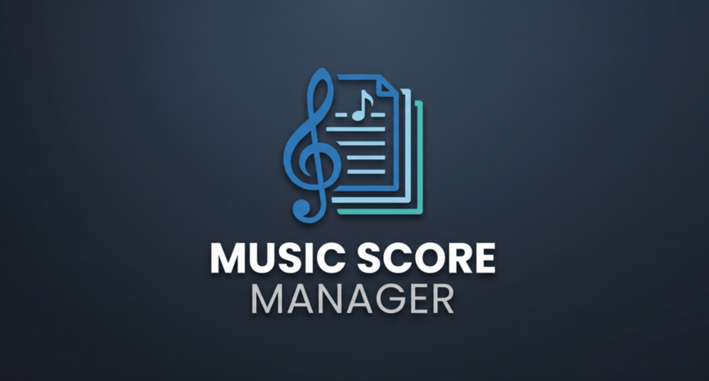

<h1 style="text-align: center;">Music Score Manager</h1>

  

Welcome to the comprehensive, in-depth documentation for **Music Score Manager**!

This application is **100% FREE and COMPLETELY AD-FREE**.  
It requires no internet connection and has zero cloud dependencies.  
It is cross-platform (**Android / Windows**).

**Music Score Manager** was custom-designed for solo musicians, ensembles, choirs, and orchestras, built upon feedback from musicians in music conservatories, concert bands, bands, and self-taught performers.

**Music Score Manager manages** your sheet music libraries, lets you read them live on stage, add annotations, organize concert programs, and much more.  
**Music Score Manager supports** PDF sheet music, and can also import image files which are automatically converted to PDF format.

**Music Score Manager does not** directly edit notes on staves, transpose audio/MIDI, or synthesize MIDI notes.

---

## Table of Contents

- [Description, Prerequisites & Installation](guide/installation.en.md)
- [Quick Start Guide (5 Minutes)](guide/quickstart.en.md)
- [Scores](guide/scores.en.md)
- [Setlists & Live Performance](guide/setlists.en.md)
- [Fullscreen Stage Viewer](guide/viewer.en.md)
- [Tools Studio](guide/tools.en.md)
- [Settings & Customization](guide/settings.en.md)
- [Quit](guide/quit.en.md)
- [FAQ](guide/FAQ.en.md)
- [Privacy Policy & Legal Notice](confidentialite.en.md)
- [Version History](Versions.en.md)

---

## 💬 Community & Support

Join the **[Audiothor Discord Server](https://discord.gg/EtZf8VyMz)** to get help, report issues, discuss hardware foot pedals, and request new features!
